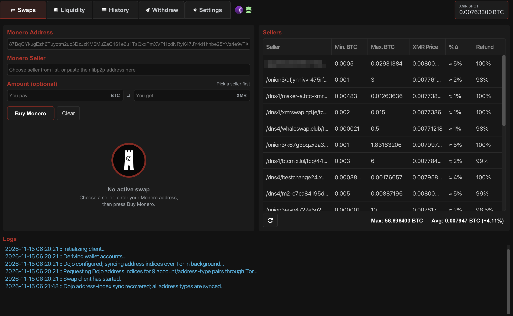
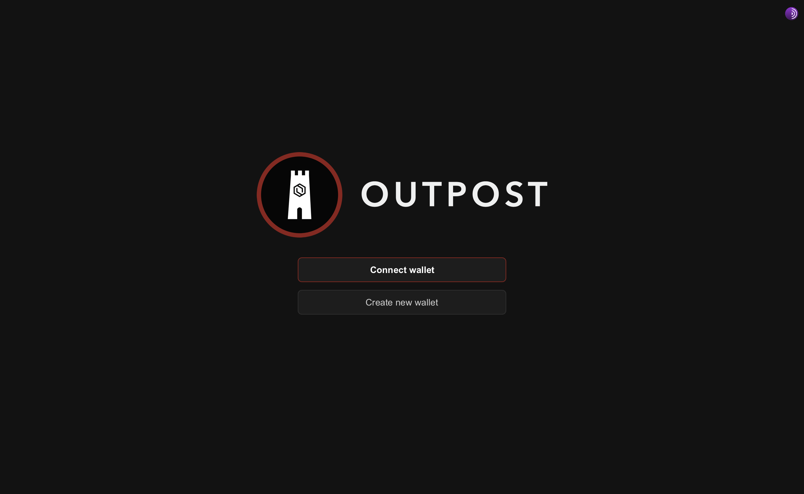

# Outpost

Outpost is a desktop app for trustless BTC ↔ XMR atomic swaps over Tor, built on the [COMIT](https://comit.network) atomic swap protocol. It is made for the [Ashigaru](https://ashigaru.rs) wallet, but you do not need one to start: Outpost can create a wallet for you (made the way Ashigaru makes one, so it opens in Ashigaru later). It also works with any standard BIP39 wallet, such as [Sparrow](https://sparrowwallet.com) ([source code](https://github.com/sparrowwallet/sparrow)). It includes an Automated Swap Backend (ASB) for selling XMR. Outpost runs the same swap protocol as [Eigenwallet](https://eigenwallet.org) 5.0.2 ([source code](https://github.com/eigenwallet/)), so it is compatible with Eigenwallet buyers and sellers (not yet heavily tested), and it is built to work with [Ashigaru Desktop](https://github.com/linkinparkrulz/ashigaru-desktop)'s upcoming swap feature (see [Client compatibility](docs/ATOMIC_SWAPS.md#client-compatibility)).

> **Outpost is a beta release.** Swap, wallet, and recovery flows have not yet been heavily stress-tested or independently audited. Test on testnet/stagenet first, use small amounts on mainnet, and keep Outpost running while a swap is active. Read the [Disclaimer](./DISCLAIMER.md) before use.

[](https://github.com/outpost-swaps/outpost/releases)



## Contents

- [For users](#for-users)
  - [Requirements](#requirements)
  - [Quick start](#quick-start)
  - [Connecting a wallet](#connecting-a-wallet)
  - [Safety and recovery](#safety-and-recovery)
  - [Documentation](#documentation)
- [For developers](#for-developers)
  - [Build tools](#build-tools)
  - [Run from source](#run-from-source)
  - [Tests](#tests)
  - [Packaging](#packaging)
  - [Project layout](#project-layout)
  - [Technical notes](#technical-notes)
- [Free Samourai](#free-samourai)
- [Roadmap](#roadmap)
- [Donations](#donations)
- [Contributing](#contributing)
- [License](#license)

## For users

### Requirements

#### Wallet

You need a Bitcoin wallet, and Outpost can make one for you. Any of these works:

- **Recommended: [Ashigaru](https://ashigaru.rs).** Connect it with its backup file or seed words (or, on older versions, its pairing payload); Outpost's swap accounts then also show up in Ashigaru.
- **No wallet yet? Create one in Outpost.** Choose **Create new wallet** when you connect: 12 words and a required passphrase, made the way Ashigaru makes them, so nothing has to be imported. At the end you can save an Ashigaru backup file, and the same wallet opens in [Ashigaru Mobile](https://ashigaru.rs) whenever you want it on your phone. See the [FAQ](docs/FAQ.md#i-created-my-wallet-in-outpost-how-do-i-open-it-elsewhere).
- **Any standard BIP39 wallet**, such as [Sparrow](https://sparrowwallet.com) ([source code](https://github.com/sparrowwallet/sparrow)): 12 or 24 words, plus the BIP39 passphrase if the wallet has one. Outpost derives its own swap accounts from the seed. See the [FAQ](docs/FAQ.md#can-i-use-a-wallet-other-than-ashigaru-such-as-sparrow).

Whichever you choose, you also need a Dojo (below). A public one works, so you do not have to run your own, but running your own is the best privacy practice (see the trade-off below).

#### Dojo

Outpost needs a Dojo backend, as Ashigaru does, including for a wallet created in Outpost. You pick one in the second step of **Connect wallet**; a public Dojo from the built-in list is enough to get started. Outpost uses the Dojo for wallet API data, balances, UTXOs, and Bitcoin fee estimates. Paired swap and ASB fee selection fails closed if Dojo is unavailable. Dojo is also tried first for Bitcoin broadcasts; Electrum is only the broadcast transport fallback. The Dojo comes with your Ashigaru pairing payload or backup file, or you choose one when you connect.

Choose one:

- **Public Dojo:** [Dojo Bay](https://dojobay.org). Convenient, but the Dojo's operator can see your wallet's addresses, balances and transaction history. It learns nothing about who you are (Outpost reaches it over Tor, so it never sees your IP address) and it cannot spend your coins.
- **Self-hosted Dojo (best privacy practice):** [Dojo OSP](https://dojo-osp.org) ([source code](https://github.com/Dojobay/dojobay)) or [RoninDojo](https://ronindojo.io).

Dojo is reached over Tor only. If it is unavailable, balances and UTXOs show as unavailable and retry in the background; there is no clearnet fallback. Whirlpool mixing also uses Dojo-backed wallet data, so it may be unavailable or fail to refresh while Dojo is down. A Dojo outage does not itself mean Electrum, rendezvous, or Monero connectivity is down.

### Quick start

#### Download a release

Prebuilt Linux, macOS and Windows packages are published on this repository's Releases page, with a `SHA256SUMS` file and its signature `SHA256SUMS.asc`. Pick the one for your system:

- **macOS:** a `.dmg` (drag Outpost into Applications) for Apple silicon (`macos-arm64`) or Intel (`macos-x64`) Macs, or the same app as a `.zip`.
- **Windows (64-bit):** an `.exe` installer (double-click and follow the steps), or a `.zip` you unpack and run (`Outpost.exe`).
- **Linux (64-bit x86):** a `.deb` (Debian, Ubuntu, Mint), an `.rpm` (Fedora, openSUSE), an `.AppImage` (any distribution: `chmod +x` it and run it; it needs FUSE 2, or run it with `--appimage-extract-and-run`), or a `.tar.gz` (run `./bin/Outpost`; run `./install-menu-entry.sh` once to add Outpost to your application menu).

Installers may be missing from a given release if one failed to build; the `.zip` and `.tar.gz` archives are always there.

Check the signature and your package before you run anything. The release key is in this repository (`docs/RELEASE_KEY.asc`).

**1. Check the signature** (the same on Linux, macOS and Windows; on Windows use Gpg4win or Git Bash):

```
gpg --import docs/RELEASE_KEY.asc
gpg --fingerprint 9F7C3A2653D38235875E99D736DC1FDCBBEA3D04   # must match the fingerprint below
gpg --verify SHA256SUMS.asc SHA256SUMS                       # must say: Good signature from "Outpost Releases"
```

**2. Check your package** against its line in `SHA256SUMS`:

- **Linux:** `grep "<file>" SHA256SUMS | sha256sum -c -`
- **macOS:** `grep "<file>" SHA256SUMS | shasum -a 256 -c -`
- **Windows (PowerShell):** `(Get-FileHash <file> -Algorithm SHA256).Hash`, compared (ignoring case) with the matching line from `Select-String <file> SHA256SUMS`

Release key fingerprint: `9F7C 3A26 53D3 8235 875E  99D7 36DC 1FDC BBEA 3D04`. It is also in the release notes and in the project announcement; compare it in more than one place. The key expires on 2028-11-14 and a new one will be published before then.

The packages are not code-signed yet. On macOS 15 and later, open Outpost once; when macOS says it cannot verify the app, click **Done**, then go to **System Settings → Privacy & Security** and click **Open Anyway** (on older macOS, right-click **Outpost.app** and choose **Open**). On Windows, choose **More info → Run anyway** in the SmartScreen prompt.

### Connecting a wallet

The wallet's network selects the Monero network too: mainnet pairs with Monero mainnet, testnet with Monero stagenet.



On first launch, press **Connect wallet** (or **Create new wallet**) and follow the four steps:

1. **Wallet:** bring in an Ashigaru backup file, seed words from Ashigaru or another BIP39 wallet (or, on older Ashigaru versions, the pairing payload from Settings → Transactions → Pair to Swaps GUI), or **create a new wallet** here.
2. **Dojo:** keep the one that came with your wallet, pick a public one, or enter your own.
3. **Servers:** choose the Electrum server and Monero node from the built-in lists, or enter your own. Every listed server is tested over Tor as the step opens, and the first one that answers is preselected. **Test connection** checks again.
4. **Connect:** check the summary; for a new wallet, optionally save the Ashigaru backup file.

Pairing can take a few minutes. On the very first launch, the start screen also downloads and verifies the Monero wallet tools over Tor (about 250 MB unpacked, 2 to 10 minutes depending on the Tor circuit). Later launches skip it. When you bring in an existing wallet, compare the fingerprint and first address the window shows with that wallet before continuing. See [Buying XMR](docs/BUY_XMR.md#pairing).

### Safety and recovery

- Keep Outpost running while a swap is active. After an interruption, reopen the app and unlock it: unfinished swaps resume automatically, and History shows each swap's state. Recovery depends on the last saved state and on-chain timelocks.
- Do not assume an interrupted swap is automatically recoverable. Keep the app open until the swap reports a terminal state.
- Swap-start failures and unexpected ASB exits are reported in the swap log; the ASB state resets rather than failing silently.
- ASB auto-Tx0/mixing is opt-in. Mixing is isolated from swap operation but has not been heavily tested.

### Documentation

- [Buying XMR (GUI guide)](./docs/BUY_XMR.md)
- [Withdrawing BTC](./docs/WITHDRAW.md)
- [Selling XMR (ASB guide)](./docs/SELL_XMR.md)
- [Settings](./docs/SETTINGS.md)
- [Swap architecture](./docs/ATOMIC_SWAPS.md)
- [Fee policy](./docs/FEES.md)
- [Privacy and network routing](./docs/PRIVACY.md)
- [Security model and limitations](./docs/SECURITY.md)
- [Rendezvous points](./docs/RENDEZVOUS.md)
- [FAQ](./docs/FAQ.md)
- [30-second Outpost spot](./docs/promo/outpost-spot.mp4): an animated intro to BTC ↔ XMR atomic swaps (MP4, with sound)

## For developers

Outpost is a JavaFX desktop app (`app/`) over a Rust swap engine (`xmr-btc-swap/`), joined through a JNI library (`src/`).

### Build tools

Common:

- JDK 25 (LTS). The pinned Gradle 9.8.2 wrapper and JavaFX 25.0.5 need it; `start.sh` finds a JDK 25 through `JAVA_HOME`, `~/.jdks` or `java_home`. `scripts/release/check-toolchain.sh` prints and validates the versions.
- Rust ([rustup](https://rustup.rs)).

Platform notes:

- **Linux:** install a C compiler and `pkg-config` (for example, `build-essential` and `pkg-config` on Debian/Ubuntu). The Linux prepare script has no extra zlib step.
- **macOS:** on Apple Silicon use an aarch64 JDK; install Homebrew zlib (`brew install zlib`), because the pinned Rust zlib bindings need its pkg-config metadata on current macOS SDKs.
- **Windows:** use a 64-bit JDK and the Rust MSVC toolchain; install the Visual Studio C++ Build Tools if rustup asks for a linker.

### Run from source

If you are building from a source checkout, run this from the repository root:

```bash
./start.sh
```

On Windows, run `start.bat`. The launcher rebuilds the ASB, price ticker, daemon-pool forwarder and JNI library on every start, then launches the GUI. The `xmr-btc-swap/` source tree must be present. With `start.sh` you can set `SKIP_PREPARE=1` to skip the rebuild, and it sets `OUTPOST_ALLOW_SELF_ASB=1` so your own ASB can be chosen as a seller for testing; packaged builds never set it.

To rebuild only the native binaries:

```bash
./scripts/prepare/prepare-linux.sh    # Linux
./scripts/prepare/prepare-macos.sh    # macOS
scripts/prepare/prepare-windows.bat   # Windows
```

### Tests

```bash
scripts/ci/check.sh                       # every check: toolchain, data, Rust app, Rust engine, Java
scripts/ci/check.sh --java-copy <dir>     # while the app is running from this tree
```

Do not run `./gradlew :app:build` or `:app:installDist` while the app is running: it replaces the jar the running app reads from.

`scripts/ci/check.sh` includes the cross-client conformance test, which checks Outpost's fee schedule, fee limits and lock-fee floor against values computed by unmodified Eigenwallet 5.0.2 (`xmr-btc-swap/protocol-v5/conformance/eigenwallet-5.0.2/`).

Protocol integration tests require Docker:

```bash
cargo test --manifest-path xmr-btc-swap/swap/Cargo.toml --test happy_path
```

### Packaging

Packaging scripts using JDK `jpackage` are in `scripts/package/`:

```bash
./scripts/package/package-linux.sh
./scripts/package/package-macos.sh
scripts/package/package-windows.bat
```

Run them from the repository root. They run the platform's prepare script, build through `./gradlew :app:installDist` and write an app image to `dist/`. The version defaults to `0.1.0`; set `APP_VERSION` to change it. On macOS, where Apple requires the internal bundle version to start above zero, `jpackage` gets `1.0.0` and the version users see is set to `APP_VERSION` afterwards. The packages are unsigned.

Releases are built by GitHub Actions (`.github/workflows/release.yml`): pushing a tag such as `v0.1.0` builds Linux, macOS and Windows packages with checksums and attaches them to a draft release. Check each package on a clean machine before publishing the release.

### Project layout

- `app/` — JavaFX GUI and Gradle application.
- `src/` — Rust JNI library used by the GUI.
- `xmr-btc-swap/` — COMIT protocol implementation and ASB.
- `libs/darkjar/` — local Java dependency.
- `xmr-btc-swap/protocol-v5/conformance/` — cross-client tests against Eigenwallet.
- `scripts/` — native build, packaging, CI and maintenance scripts.
- `.github/workflows/` — the release build.

### Technical notes

#### Bitcoin accounts used by swaps

Mainnet:

- Swaps main account: `m/84'/0'/2147483643'`
- Swaps refund account: `m/84'/0'/2147483642'`
- ASB main account: `m/84'/0'/2147483641'`

Testnet:

- Swaps main account: `m/84'/1'/2147483643'`
- Swaps refund account: `m/84'/1'/2147483642'`
- ASB main account: `m/84'/1'/2147483641'`

The swap-specific `SWAPS_DEPOSIT`, `SWAPS_REFUNDS`, and `ASB` accounts are native SegWit. The standard Ashigaru `DEPOSIT` account can contain Legacy, wrapped-SegWit, and native-SegWit UTXOs; `POSTMIX` is native-SegWit. The Withdraw page and Liquidity balances query each account's configured address types.

#### Seed handling

The GUI passes the paired root seed to the bundled ASB through stdin, so no plaintext `seed.pem` handoff file is created. The seed remains available to the running GUI process; protect the machine and the app's data directory.

## Free Samourai

Outpost carries on the work of Samourai Wallet, whose developers, Keonne Rodriguez and William Hill, were prosecuted for writing privacy software. Don't forget them. Learn more and support them at [freesamourai.com](https://freesamourai.com) and [billandkeonne.org](https://billandkeonne.org).

## Roadmap

Planned next, in no fixed order:

- **Flatpak** package for Linux (sandboxed, installable from a single file).
- **Windows `.msi` installer** for managed and enterprise setups (the `.exe` installer is available now).
- Easier backup and restore of swap state.
- Newer bundled Tor.

## Donations

Outpost is free and open source. If it is useful to you and you would like to support its development, you can donate Monero (XMR):

```
87KLBCf4fpR1kCiy7JN66XSDGXRi7kV4EPnGXCjP6pcDNpfnm7iSGci6b3oxniSWqRAXaEg8iabraWZoLtm9VvfVTzKsU9R
```


## Contributing

Contributions are welcome.

1. Fork this repository and clone your fork.
2. Create a feature branch: `git checkout -b my-new-feature`.
3. Commit your changes: `git commit -am 'Add some feature'`.
4. Push the branch: `git push origin my-new-feature`.
5. Open a pull request.

## License

[GNU General Public License 3](./LICENSE). See also the [Disclaimer](./DISCLAIMER.md).

Outpost is based on the COMIT [`xmr-btc-swap`](https://github.com/comit-network/xmr-btc-swap) protocol implementation.
