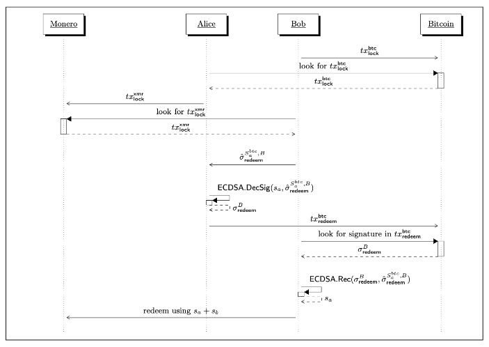
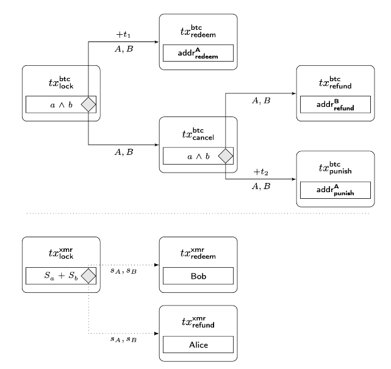

# XMR-BTC Atomic Swaps

Outpost is a JavaFX GUI for COMIT XMR-BTC atomic swaps with an Automated Swap Backend (ASB), paired Ashigaru wallet integration, Tor, and opt-in Whirlpool mixing for eligible ASB BTC.

Swaps can be interrupted by network, peer, or process failures. Keep the application running while swaps are active; it resumes unfinished swaps automatically when it is open and unlocked.

Learn more about building and running the program [here](../README.md).

Learn more about getting started with the Swaps GUI [here](BUY_XMR.md).

[FAQ](FAQ.md)

## XMR-BTC atomic swaps current landscape

### COMIT

COMIT has published two tools for XMR-BTC atomic swaps:

* 'swap': CLI app for selling BTC in exchange for XMR.
* 'asb': CLI app that acts as a XMR liquidity provider.

Both tools are written in Rust. This application carries its own COMIT-derived protocol source under `xmr-btc-swap/`; check that source for current compatibility and status.

The COMIT whitepaper provides the technical details on their implementation (see [below](#white-papers)).

## Protocol hardening in this fork

This fork has hardened the swap protocol's failure handling beyond the frozen COMIT codebase. COMIT is no longer maintained; Eigenwallet and Outpost are sibling forks of it. Quotes use Eigenwallet's current `bid-quote/2.0.0` protocol (verified against live makers). Both the buy/taker path and the built-in ASB/maker path now use swap-setup `5.0.0`; legacy `1.0.0` swaps are recovery-only. Detailed internal reviewer notes are maintained separately from this repository.

### Client compatibility

Outpost buying and the built-in Outpost ASB both use `/comit/xmr/btc/swap_setup/5.0.0`, the protocol of current Eigenwallet (5.0.2).

- **[Eigenwallet](https://eigenwallet.org)** ([source code](https://github.com/eigenwallet/)): compatible in both directions (an Outpost buyer with an Eigenwallet seller, and an Eigenwallet buyer with an Outpost ASB): the messages, timelocks and presigned fees match Eigenwallet's code. Cross-client swaps have not yet been heavily tested, so start with small amounts. Eigenwallet sellers price their swap transactions with their own estimator, which on a quiet network can read several times above what is needed; Outpost then asks you whether to accept that rate (see [Buying XMR](BUY_XMR.md#starting-a-swap)). Outpost buyers also pay at least 500 sats for the lock, which Eigenwallet sellers require ([Fees](FEES.md#lock-fee)). An automated test checks Outpost's fee schedule, fee limits and lock fee against values computed by unmodified Eigenwallet 5.0.2, so a change that would break this is caught before release.
- **Testnet:** Outpost's test network is **testnet4** (with Monero stagenet). Eigenwallet's public testnet sellers watch **testnet3**, so a swap with them stops at setup ("Input verification was inconclusive": they cannot find your testnet4 coins). Test cross-client swaps on mainnet with small amounts, or with a seller running on testnet4.
- **[Ashigaru Desktop](https://github.com/linkinparkrulz/ashigaru-desktop):** Ashigaru Desktop has a swap feature in development (announced publicly; its working branch is public, not yet released). It embeds Eigenwallet's swap engine as a buyer, so once released an Ashigaru Desktop user should be able to buy XMR from an Outpost ASB. This has not been tested.

 Versions do not negotiate: a peer on the legacy `1.0.0` wire format can appear in the seller list via the shared quote protocol but fails at setup with a 5.0 peer. Legacy `1.0.0` database entries remain available for recovery only.

- **BTC broadcast path:** signed Bitcoin transactions are offered to the paired Dojo first (authenticated `/pushtx/`, 15-second budget per attempt, up to two attempts), then the same bytes are broadcast through Electrum if both Dojo attempts fail or time out. Retries reuse the identical transaction, so a timeout followed by a fallback broadcast cannot create a conflicting transaction.
- **BTC redeem retries:** when the taker's Bitcoin redeem broadcast fails transiently (network/Electrum hiccups), it is retried with backoff until the cancel timelock expires. If the timelock wins the race, the chain is checked before cancelling: a redeem that actually landed is never cancelled away.
- **XMR lock finality checks:** before treating the Monero lock as final, the wallet verifies the lock transaction is not double-spent, and a persistently unresolvable lock (e.g. vanished in a deep reorg) fails the swap into the cancel/refund path instead of waiting forever.
- **Swap-setup cryptography:** the cross-curve proof that binds a party's Bitcoin and Monero keys is built from unknown-discrete-log ("NUMS") generators, matching the active fork's post-fix network.
- **Lock transaction validation:** the funded lock transaction is accepted only if it pays exactly the agreed amount to exactly one shared output.
- **Durable swap accounts:** a swap only starts after its account record is persisted; a failed persistence write aborts the start instead of leaving a swap without recoverable account data.
- **ASB lifecycle surfacing:** a failed ASB launch or an unexpected ASB process exit clears the running state and reports the error in the swap log, instead of showing a "running" ASB that does not exist.

### ASB liquidity: fee reserve and reservations

An ASB must never accept a swap it cannot fund: the buyer would lock Bitcoin and get it back only through the cancel/refund timelocks, paying lock, cancel and refund fees for nothing. This happened once in testing (2026-10-12: the Monero fee reserve was too small for the real lock fee), and the ASB now prevents it in two ways:

- **Fee reserve:** quote sizing and the pre-lock setup check both leave **0.003 XMR** for the Monero lock fee (Eigenwallet's reference value, about four times the highest average daily Monero fee in a year), so an ASB advertises only what it can fund and refuses at quote or setup time, before the buyer locks BTC. The reserve is a margin, not a spend. See [SELL_XMR.md](SELL_XMR.md#xmr-liquidity-and-fee-reserve).
- **Reservations:** each accepted swap reserves its Monero for the swap's lifetime. Quotes, setup checks and quote refreshes subtract reserved amounts; reservations survive ASB restarts (rebuilt from saved swap states) and are released only at a terminal state, so a failed swap keeps its reservation while it may still need it for recovery.
- **Buyer side:** the swap amount is `min(deposited funds, seller's advertised max)`, and the selected seller's row is reconciled with the live quote when the order is created.

What remains is bounded griefing: a dishonest maker can still accept swaps it never intends to fund and so burn the buyer's fees (the principal stays protected by the timelocks). A reputation system is the long-term defense.

### Threat model: punish and buyer fund safety

The punish transaction exists to penalize a taker who abandons a swap after the maker locked XMR; it pays the setup-time punish address in the maker's wallet. Abuse analysis:

- **A maker can always burn buyer fees** (lock, cancel, refund) by accepting swaps it never intends to fund — bounded griefing; the fee-reserve fix and liquidity-reservation work (above) address the accidental and structural versions. A verified-reputation system is the long-term defense.
- **The BTC principal is only punishable while the buyer's client is offline** through the cancel confirmation plus the punish timelock (**30 cancel + 144 punish blocks on mainnet; 42 + 72 on testnet/stagenet**; legacy 1.0 recovery-only swaps used 72 + 72 and 12 + 6). A running client refunds automatically at cancel+1 confirmation — the client alone can publish cancel (no maker participation needed) and the refund needs no maker either. The realistic principal-theft scenario is an abandoned client: a malicious maker fails to lock XMR, the buyer closes the app, and the maker punishes after the timelocks. Users with locked BTC should keep the app running until History shows a terminal state. Errors after the lock resume the same swap rather than ending it, and the punish timelock passing alone does not end it either: the client keeps trying the refund until a punish transaction is actually confirmed.
- **A seller cannot quote one price and charge another:** the buyer compares the fresh quote it asks for after the deposit with the price the swap started with and stops if the price got more than 2% worse, then refuses a setup offer more than 1% below that fresh price. Both checks run before anything is signed or locked, and the buyer's own Monero-lock check then requires one spendable output of exactly the agreed amount before the redeem signature is released.
- **Fee-race and pinning resistance (protocol 5):** the cancel and refund transactions are version-3 (TRUC) transactions, and the refund input carries a one-block relative timelock, which is how Eigenwallet's protocol 5 closes the fee race between cancel, refund and the maker's redeem (Eigenwallet PR #1243). Outpost's protocol-5 tests assert both properties.
- **Punish is timelock-gated and fail-closed everywhere in this fork:** the manual `asb manual-recovery punish` command and the ASB startup auto-recovery sweep both verify on-chain that the punish timelock has expired before broadcasting; if the verification errors, they refuse. They cannot punish a refundable, unfunded, or already-spent swap.
- **ASB auto-recovery sweep:** at startup (and every 15 minutes), the ASB scans for swaps stuck in `SafelyAborted` whose BTC lock is funded and whose punish timelock expired — the state where the locked BTC is spendable *only* via punish (e.g. the maker aborted pre-XMR-lock, the buyer cancelled, and the refund window closed). It recovers the swap keys from the persisted state history and publishes the punish transaction to its own wallet (`ASB_AUTO_PUNISH_TX` in the log); anything not exactly in that situation is skipped (`ASB_AUTO_PUNISH_SKIPPED`). This reclaims the maker's own wallet-bound funds after the incident-class failure without manual commands.

### Bitcoin fee architecture (this fork)

See [FEES.md](FEES.md) for the selection/fallback diagrams, fee formula, and the remaining mainnet verification.

**The problem.** The frozen COMIT code prices every swap transaction with a single electrs `estimate_fee` call. On a quiet chain (testnet routinely; mainnet at night) electrs returns `-1`, that code falls back to 1 sat/vB, which is below Bitcoin Core's minimum relay rate, so the fee clamps to `relay_fee × 1.25` — a **flat 1250 sats regardless of amount**. On a ~137 vB redeem that is an effective 9.14 sat/vB, roughly 10x what the market was clearing at the time of measurement, on every swap, forever.

**Dojo next-block estimator.** The pairing's Dojo node answers the question electrs can't: *"what rate gives me probability P of confirming in the NEXT block?"* — confidence targets 0.999 / 0.99 / 0.9 / 0.5 / 0.2 / 0.1 straight from the operator's own full node's mempool. The Rust wallet fetches it Tor-routed with the pairing API key, deduplicates requests for 30 seconds per setup, and retries for up to 60 seconds. For all new Outpost swap setups and the ASB the estimator is required: the decrypted Dojo URL/key are passed explicitly to Rust, and if Dojo fails after the retry window setup aborts rather than using Electrum. Resume/recovery uses the fees already signed at setup and does not reprice; if it needs a fresh fee, it fails closed instead of using Electrum. The app's Withdraw tab uses the same estimator with 99% / 50% / 10% one-click buttons, or a manual sat/vB entry if Dojo is unavailable; it never falls back to Electrum and does not use the swap fee policy.

**Per-transaction fee structuring (v5).** Alice advertises one Dojo rate in `Message1.fee_rate`, raised to at least 1 sat/vB. Bob measures the largest presigned transaction template with maximum-size signatures, then prices every spending path from that measurement:

| Transaction | Broadcast by | v5 fee | Why |
|---|---|---|---|
| Lock | Bob | local target-2/target-1 and Alice-advertised rate, each ×1.25; re-measured after construction | Starts the swap; a stuck lock can hit the ASB confirmation timeout. If change or extra inputs increase the weight, the fee is raised to preserve the rate |
| Redeem | Alice | `base × redeem_multiplier`, default 2.5× | Captured at setup but broadcast after lock finality and XMR lock. At least 2× so it can replace an unconfirmed cancel |
| Cancel | Bob | `base` | Starts the refund clock |
| Refund / early refund | Bob | `base` | Failure path; principal-critical |
| Punish | Alice | `base` | Alice's recovery transaction |
| Partial refund / reclaim / withhold / mercy | Bob or Alice as applicable | `base` | Anti-spam deposit failure paths |

`base = ceil(rate_sat_per_kvb × measured_max_vsize / 1000)`. The most expensive path must fit `min(100,000 sats, btc_amount / 3)`; that is the v5 budget check. Bob also validates Alice's advertised rate within half to 3× his local estimate. The v5 model does **not** apply the legacy 2× cancel/refund buffer or the legacy 20% per-transaction cap.

All swap fees are fixed **at swap setup** (not app startup). The old GUI 1.0 fallback used 1.25× lock/redeem and 2× cancel/refund/punish with a 20%/100k cap; see [FEES.md](FEES.md) for the legacy section.

**Why fees are frozen at setup — and cannot be re-estimated later.** Every recovery transaction (cancel, refund, punish, redeem) spends the shared `and_v(pk(A), pk(B))` output, which requires **both** parties' signatures. The signatures are exchanged *during the swap setup* precisely so every recovery path works unilaterally later: Bob's encrypted redeem signature decrypts against the XMR lock secret, the cancel signatures are pre-traded in the handshake, Alice's punish signature is pre-given. A signature commits to the exact transaction — including its fee — so re-pricing at execution time would invalidate the pre-exchanged signature and require live counterparty cooperation, defeating the whole point of unilateral recovery. Relatedly, the same transaction is never fee-bumped later. v5 does allow redeem to replace an unconfirmed cancel via RBF (cancel signals RBF and redeem pays at least 2× base); that changes which transaction confirms, not the redeem txid. The client derives the XMR sweep key from the exact redeem transaction, so the redeem txid must stay stable.

This makes the fee structuring itself a security feature: the one-time setup-time estimate is the *only* lever. In v5 the maker's measured templates and the 2.5× redeem fee protect the spending paths; in the legacy 1.0 fallback the cancel/refund pair gets a 2× rate buffer because its failure can cost principal.

Learn more about building and running the program [here](../README.md).

[COMIT github repo](https://github.com/comit-network/xmr-btc-swap)

[COMIT Monero-Bitcoin Atomic Swap Blog Post](https://comit.network/blog/2020/10/06/monero-bitcoin/)

#### On-chain Protocol

#### TX Schema

### Farcaster

The whitepaper written by Joel Gugger (*h4sh3d@protonmail.com*) served as a basis for Farcaster development. Farcaster tools are more numerous but as of yet there have been no services identified building on top of them. Farcaster swap tools are written in Rust.

[Farcaster github repo](https://github.com/farcaster-project)

### White Papers

The two above mentioned whitepapers have been uploaded to this repo:

[Atomic Swaps between Bitcoin and Monero](./files/Atomic_Swaps_between_Bitcoin_and_Monero-COMIT.pdf) (COMIT)
 
[Bitcoin-Monero Cross-chain Atomic Swap](./files/Bitcoin–Monero_Cross-chain_Atomic_Swap.pdf) (Farcaster)
