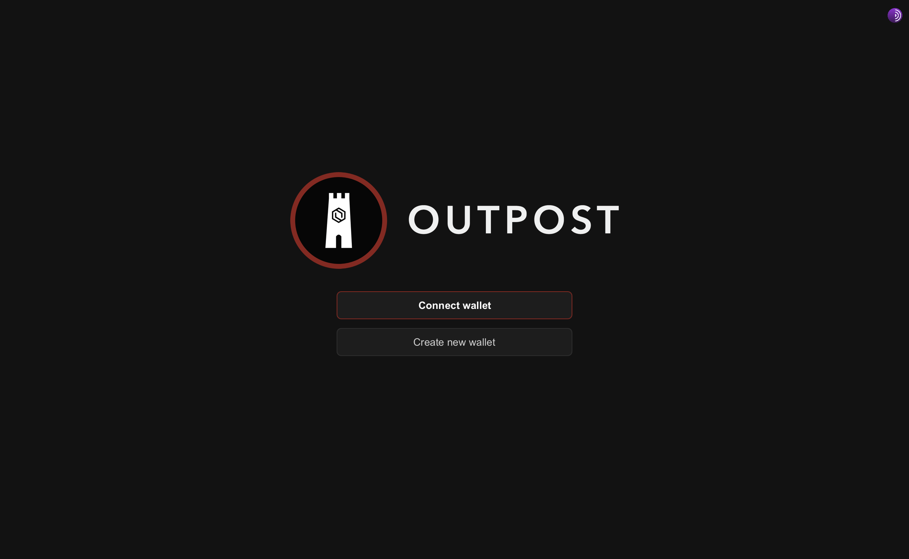
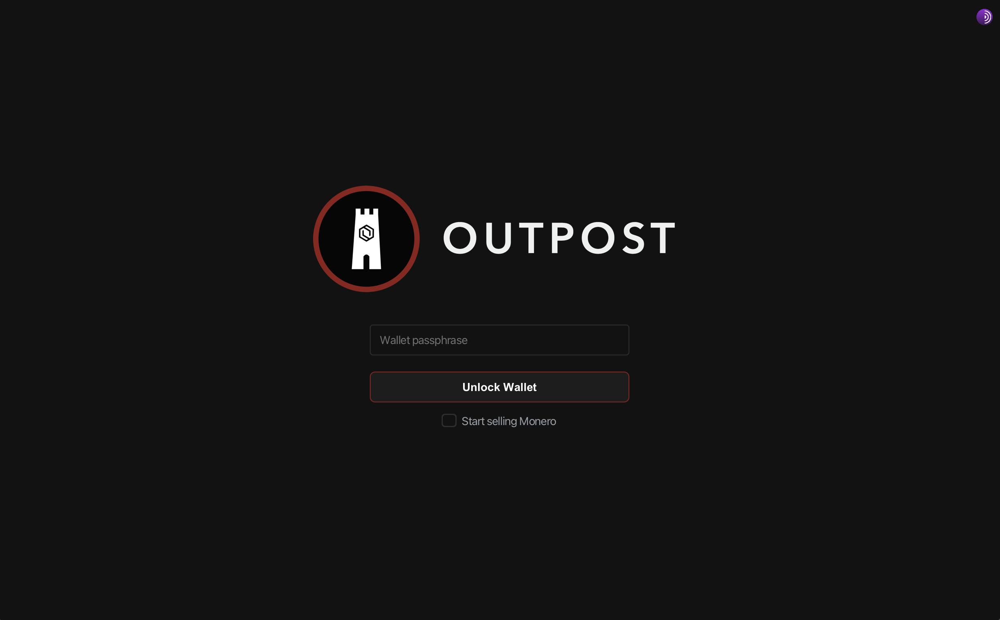
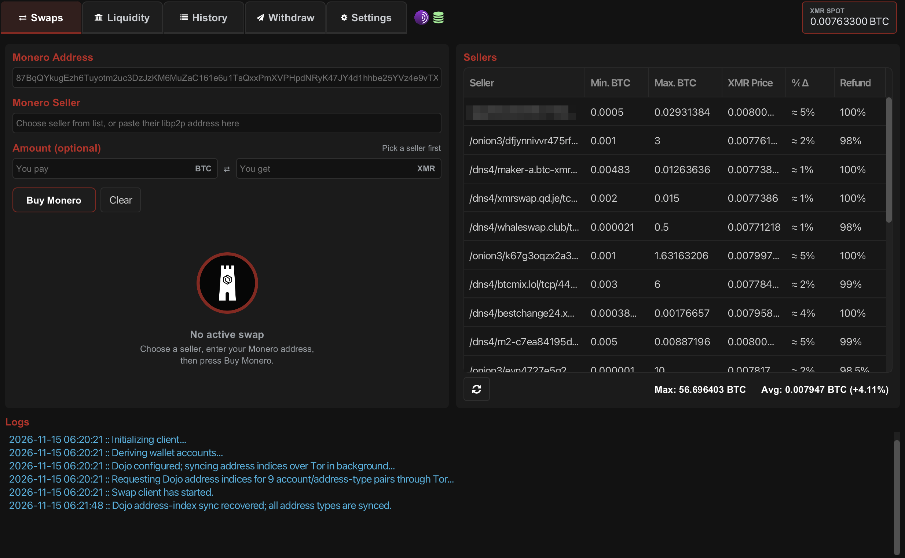
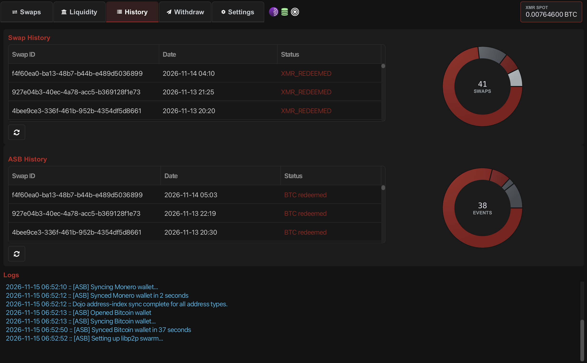

# Buying XMR

> **Outpost is a beta release.** Swap, wallet, and recovery flows have not yet been heavily stress-tested or independently audited. Test on testnet/stagenet first, use small amounts on mainnet, and keep the application running while a swap is active.

Outpost is a desktop client for BTC → XMR atomic swaps. This guide covers pairing, funding, and completing a swap.

## Contents

- [Before you start](#before-you-start)
- [Pairing](#pairing)
  - [1. Wallet](#1-wallet)
  - [2. Dojo](#2-dojo)
  - [3. Servers](#3-servers)
  - [4. Connect](#4-connect)
  - [Later launches](#later-launches)
- [Starting a swap](#starting-a-swap)
- [Depositing Bitcoin](#depositing-bitcoin)
- [The Bitcoin lock transaction](#the-bitcoin-lock-transaction)
- [The Monero lock transaction](#the-monero-lock-transaction)
- [The Bitcoin redeem transaction](#the-bitcoin-redeem-transaction)
- [The Bitcoin cancel/refund transactions](#the-bitcoin-cancelrefund-transactions)
- [Early refund](#early-refund)
- [Partial refunds (seller deposits)](#partial-refunds-seller-deposits)
- [The Bitcoin punish transaction](#the-bitcoin-punish-transaction)
- [Resume swap](#resume-swap)

## Documentation

- [Selling XMR](SELL_XMR.md)
- [Withdrawing BTC](WITHDRAW.md)
- [Fees](FEES.md)
- [Settings](SETTINGS.md)
- [Swap architecture](ATOMIC_SWAPS.md)
- [Privacy and network routing](PRIVACY.md)
- [Security model](SECURITY.md)
- [Rendezvous points](RENDEZVOUS.md)
- [FAQ](FAQ.md)

## Before you start

- Pair the app with an [Ashigaru Wallet](https://ashigaru.rs). Ashigaru requires a Dojo backend.
- Choose a Dojo: public [Dojo Bay](https://dojobay.org), or self-host with [Dojo OSP](https://dojo-osp.org) ([source](https://github.com/Dojobay/dojobay)) or [RoninDojo](https://ronindojo.io). You choose it when you connect; a pairing payload or backup file brings its own.
- Dojo is Tor-only. There is no clearnet fallback.

> **If a swap does not complete, keep Outpost open and unlocked.** Your Bitcoin is locked with the seller until the swap finishes. If the seller never locks the Monero, the swap is cancelled **30 blocks** after your Bitcoin lock confirms (about 5 hours on mainnet), and Outpost then broadcasts your refund straight away. After the cancel you have **144 blocks** (about 24 hours) to claim that refund: past that point the seller can take the Bitcoin (the *punish* transaction), so a failed swap should never be left unattended for a day. On testnet the numbers are 42 and 72 blocks. Block times vary, so the hours are estimates. Details: [cancel/refund](#the-bitcoin-cancelrefund-transactions) and [punish](#the-bitcoin-punish-transaction).

## Pairing

On first launch the start screen has two buttons: **Connect wallet** for a wallet you already have, and **Create new wallet**. Both open the same window with four steps: **Wallet**, **Dojo**, **Servers** and **Connect**.

### 1. Wallet

Choose how to bring in your wallet, or create one.

**Seed words**

- Enter the 12 or 24 words, the BIP39 passphrase (leave it empty if the wallet has none) and the network.
- The words and the passphrase carry no Dojo information, so you choose the Dojo in step 2.
- This also works for other standard BIP39 wallets such as Sparrow; see the [FAQ](FAQ.md#can-i-use-a-wallet-other-than-ashigaru-such-as-sparrow).

**Backup file**

- Choose Ashigaru's encrypted backup file and enter the wallet's passphrase.
- The backup holds the seed, the passphrase, the network and the Dojo.
- Ashigaru only writes a backup for wallets that have a passphrase.

**Pairing payload**

- In Ashigaru, open **Settings → Transactions → Pair to Swaps GUI**, copy the payload (encrypted with your wallet passphrase), paste it, and enter the passphrase. It carries your Dojo too.
- Recent Ashigaru Wallet versions removed this setting; older ones still have it.

**Create new wallet**

- Choose the network and a passphrase (required, at least 8 characters, typed twice), then press **Generate words**.
- Write the 12 words on paper in order, then type back the three words the window asks for.
- The wallet is made the way Ashigaru makes one (12 BIP39 words plus a BIP39 passphrase), so it also opens in Ashigaru Mobile.
- In step 3 you can **Save backup file...**: an Ashigaru backup file, encrypted with your passphrase, that carries the Dojo you chose.
- **Without both the words and the passphrase the funds are lost; nobody can reset either.**

**Check the fingerprint**

As soon as the wallet opens, the window shows its **fingerprint, a small picture (the same LifeHash that Ashigaru Desktop and Sparrow draw for a fingerprint) and its first receive address.** Compare them with your wallet. If they differ, the words or the passphrase are wrong.

**A wrong passphrase gives no error: it opens a different, empty wallet.**

### 2. Dojo

Pick the Dojo your balances and fee estimates come from:

- the one that came with your wallet (listed first when there is one)
- a public Dojo from a built-in list
- your own (paste its pairing JSON, or enter its URL and API key)

**The public list**

The public list is Dojo Bay's directory.

- When the window opens it is fetched over Tor (never over the clearnet), and every entry's signature is checked, so a listing cannot be forged or altered. Entries whose signature does not check out are skipped.
- The last good list is kept on this computer and checked again each time it is used.
- If Dojo Bay cannot be reached, that list (or, failing that, the one that shipped with the app, which may be out of date) is shown, and the note under the list says which one you are looking at.

**Good to know**

- A public Dojo sees every address in your wallet. If one will not connect, pick another or ask its operator.
- **Test connection** logs in to the chosen Dojo over Tor with its URL and API key and shows the result in green or red. A Dojo that fails can still be chosen, but pick another if you can.

### 3. Servers

Choose the **Electrum server** the swap engine follows the Bitcoin chain through, and the **Monero node** your Monero wallets sync from.

- Each comes preselected from the built-in list for your network. When the step opens, every listed server is tested at once and the first one that answers is preselected (until you pick one yourself).
- Or choose **Another server** / **Another node** and enter its address (for example `tcp://server.onion:50001` or `http://node.onion:18089`).
- The Electrum list also includes the servers of the verified Dojos in Dojo Bay's directory. Those are tested like the others, but preselected only while none of the packaged servers works.

**Personal node**

Tick **Personal node** only for a node you run yourself. On mainnet, Outpost then trusts it alone to confirm the seller's Monero lock instead of asking witness nodes. A node you merely trust is not enough.

**Test connection**

**Test connection** checks the server over Tor: the Electrum server must be on the right chain, the Monero node synced and on the right network. A server that fails the test can still be used, but pick another if you can.

Both can be changed later in Settings, where your own ones show as **Personal**.

### 4. Connect

A summary of the wallet, Dojo and servers.

- If the wallet has no passphrase of its own you choose a password here: it encrypts the wallet on this computer and unlocks the app.
- You can also tick **Also start the ASB**.
- **Connect** then starts pairing. The start screen shows its steps and stays locked until it finishes, which can take a few minutes.

### After pairing

The imported wallet is stored encrypted, exactly as a paired one is, and the words are cleared from the window when it closes. Connecting a Testnet wallet configures Outpost for Testnet/Stagenet.

### Later launches

On later launches the start screen shows the unlock page instead: enter your wallet passphrase to open the app. Tick **Start selling Monero** to start the ASB at the same time.

## Starting a swap

Once paired, you will be greeted with the following screen (see screenshot below).

This is the **Swaps** tab. The seller list has two sources:

- Community-run [rendezvous points](RENDEZVOUS.md).
- A small curated list of public mainnet makers dialed directly, so listing still works when rendezvous points are unreachable. It is a fallback, not an endorsement; the current snapshot is mainnet-only and is skipped on testnet/stagenet.

The list refreshes on its own every 10 minutes while no swap is running, and whenever you press the refresh button. (It used to refresh every 2 minutes, which was often enough for some sellers to start refusing connections.)

The **Refund** column shows how much of your Bitcoin a failed swap returns straight away: `100%` for most sellers, less for a seller that asks for an anti-spam deposit (see [Partial refunds](#partial-refunds-seller-deposits)).

A listed maker is not guaranteed to complete a swap. Outpost buys XMR with swap-setup `5.0.0`, the protocol of current Eigenwallet (5.0.2), so it is compatible with Eigenwallet sellers (not yet heavily tested). A maker still on the legacy swap-setup `1.0.0` can answer the shared quote request but fails at setup. See [Client compatibility](ATOMIC_SWAPS.md#client-compatibility).

To initiate a swap from Bitcoin to Monero, choose an offer, enter a Monero address, and click **Buy Monero**. Review the seller's minimum/maximum and quoted price before proceeding.

The optional **Amount** boxes give you an estimate before you commit. Type an amount in either box (BTC on the left, XMR on the right) and the other fills in for the seller you picked, after the Bitcoin lock fee and the Monero sweep fee. A note above the boxes tells you if the amount is below the seller's minimum or above its maximum, or if no seller is picked yet. It is only a guide: the amount you actually get is set after your deposit arrives, from the seller's fresh quote. The two small boxes beside the buttons show the picked seller's price in both directions, and **Clear** empties the amounts along with the other fields.

During setup the seller states how much Monero it will send for your Bitcoin. Two checks protect you, both before any Bitcoin is locked. First, once your deposit has arrived your client asks the seller for a fresh quote and compares it with the price the swap started with (the "Received quote" line in the log): if the seller's price got more than 2% worse in the meantime, the swap stops and tells you both prices. Nothing is sent and your deposit stays in your swap wallet; start again to see the seller's current price, or pick another seller. Second, it refuses the swap if the Monero the seller offers in setup is more than 1% below that fresh price. A small difference from the price shown when you chose the seller is normal: the market moves while you deposit.

The seller also states the fee rate its swap transactions will be priced at. If that is more than three times what the network needs, Outpost stops the swap before any Bitcoin is locked and shows both rates, for example "The seller wants its swap transactions priced at ~6.1 sat/vB. The network currently needs ~1.0 sat/vB, and Outpost accepts up to ~3.0 sat/vB", with two choices:

- **Try another seller** (the default): nothing changes, nothing is locked.
- **Accept ~6.1 sat/vB and retry**: a new swap with the same seller starts at once and allows that rate (plus a small margin) for that one swap. Nothing is saved; your next swap is protected again.

Accepting costs nothing extra if the swap succeeds, because the seller pays its own redeem fee out of its Bitcoin. Only a failed, refunded swap pays the higher rate, and the dialog shows roughly how much more (`~1858 sats` in the example) and the worst case for the longest refund path, in sats and as a share of your swap (for example `~4,440 sats (0.44% of this swap)`). A seller asking far less than the network needs is always refused.

### When a seller fails during setup

Sellers are independent operators. Some are slow, briefly offline, or have a problem of their own, so a swap can stop during setup even though the seller was listed a minute ago. The swap panel says why:

- **Seller had a problem on its side.** The seller's own price feed or wallet failed at that moment.
- **Seller's offer didn't match its quote.** The seller quoted one price and offered another during setup. Outpost refuses it (see the price check above).
- **The seller's price got worse after the swap started.** The fresh price was more than 2% higher than the one the swap started with. Outpost stops before anything is signed and shows both prices (see the price check above). Start again to see the current price, or pick another seller.
- **Amount is outside this seller's limits**, **This seller has too little Monero**, or **This seller isn't accepting swaps.**

In every one of these nothing is locked: setup fails before the Bitcoin lock transaction, and your deposit stays in your swap wallet, where the next swap uses it. **Try another seller** from the list. Choose one with a `100%` Refund, a Min and Max that comfortably include your amount, and, if connections to an onion seller keep timing out, one reached by domain (`/dns4/...`). The same seller can appear in more than one row with different addresses; the peer ID at the end is the same. A seller that failed may work again later.

## Depositing Bitcoin

When you click **Buy Monero**, your client checks the peer. If `SWAPS_DEPOSIT` does not already cover the swap amount, it displays a Bitcoin deposit address derived from that account; otherwise it can use the existing balance. Verify the address and amount before sending. The corresponding derivation paths are listed under [Bitcoin accounts used by swaps](../README.md#bitcoin-accounts-used-by-swaps) in the README.

Send the requested amount to the displayed address with a fee appropriate for timely confirmation. While it waits, the client asks the paired Dojo for new unconfirmed deposits about every five seconds and runs a full Electrum sync only every couple of minutes (each bounded to 30 seconds), so an unconfirmed deposit is normally noticed within seconds instead of after a full Electrum sync over Tor. Once funded, the client sets up a swap with the peer and prepares the protocol transactions:

- Bitcoin lock transaction
- Bitcoin redeem transaction
- Bitcoin cancel/refund transaction
- Bitcoin punish transaction

The transaction flow is summarized [here](FAQ.md#what-is-the-flow-of-transactions). Fee selection and setup-time timing are covered in [Fees](FEES.md); every swap fee is fixed before broadcast and cannot be repriced with a same-transaction RBF bump or CPFP. v5 may replace an unconfirmed cancel with redeem; that is a protocol recovery path, not a fee reprice.

Tor or peer connectivity can be slow or interrupted. Before taking recovery action, check History and the current swap state; do not assume a missing UI update means no transaction was broadcast.

If a lock transaction has been broadcast, recovery is governed by the protocol's on-chain timelocks and transaction state. The app resumes the swap whenever it is open and unlocked; History shows its state, and the [FAQ](FAQ.md) covers recovery. Do not rely on a fixed confirmation count across networks or protocol configurations.

## The Bitcoin lock transaction

See [who pays which fee](FEES.md#who-pays-which-fee) for the lock fee and buffer.

Once the setup process with the peer finishes, a Bitcoin lock transaction is broadcast to the network. The client offers it to the paired Dojo first and falls back to Electrum if Dojo is unavailable or slow. This locks your Bitcoin with the peer until the swap either completes or fails.

Upon confirmation of the Bitcoin lock transaction, your trading partner should lock their Monero and respond with the lock proof.

**From here on, keep Outpost running.** If the swap stalls, the cancel timelock is 30 blocks (about 5 hours) on mainnet, then you have 144 blocks (about 24 hours) to refund. See [Before you start](#before-you-start).

## The Monero lock transaction

Once the Monero lock transaction has been broadcast, your client watches for confirmations. The swap log and tracker report observed confirmation counts as the wallet checks them; counts may jump if multiple confirmations arrive between checks. Before that, your client asks other independent Monero nodes (witnesses, mainnet only) to confirm the lock exists and has reached the finality target; if they disagree or cannot be reached, it does not send the signature. This also applies when a swap is resumed between the Monero lock and the signature. This is skipped only when your Monero **Node Type** is **Personal node** (see [Settings](SETTINGS.md)). Once the configured Monero finality target is reached, your client sends a Bitcoin transaction signature to the peer so they can broadcast the Bitcoin redeem transaction.

If the Monero lock transaction does not confirm, the protocol's Bitcoin timelocks govern when cancellation/refund can proceed. Keep the swap resumed and verify its state in History.

If your trading partner does not publish the Monero lock transaction, the protocol's on-chain timelocks determine when recovery actions become valid. Keep the swap running and monitor its History state; do not rely on the peer remaining online.

## The Bitcoin redeem transaction

The redeem fee is fixed at setup and included in the [fee table](FEES.md#who-pays-which-fee).

Once the transaction signature has been received by your trading partner, they will be able to broadcast the Bitcoin redeem transaction. This transaction releases the Bitcoin from the lock transaction, moving the coins to a wallet entirely controlled by your trading partner.

The broadcast of the redeem transaction instantly reveals the necessary key data needed to redeem the Monero on your end. Your trading partner will not be able to take back the Monero themselves at this point, and it is not necessary to redeem the Monero immediately, but it is recommended to sweep the coins into a wallet you're more comfortable with. The program handles this for you automatically upon broadcast of the Bitcoin redeem transaction using the Monero address provided at the start of the swap.

The swap log and tracker show each phase as it begins. Once the Monero lock reaches its finality target, **BTC redeemed** becomes the current step and reads *waiting for seller*; when the seller claims your Bitcoin it reads *claimed*, and **XMR redeemed** follows with *preparing*, *sweeping* and finally *swept*. After a resumed swap, the tracker shows only confirmation counts observed during that run.

When the swap completes, the panel shows **Swap Success** and, above it, the exact Monero sent to your address and the Monero network fee of the sweep (for example `0.12517824 XMR` / `Network fee: 0.00012176 XMR`). The amount is exact: the seller's lock must pay exactly the agreed amount, and the sweep fee is public on the Monero chain. If the app cannot work it out (for example a swap that had already completed before it was resumed), it shows no number rather than an estimate. The swap log records the same figures.

Congrats! You've completed your first BTC->XMR atomic swap!

"But wait, what if something goes horribly wrong during the swap? Like a power outage, or internet outage, or your trading partner disappears into the sunset, or a nuclear apocalypse starts?"

If an error happens after your Bitcoin may be locked (a network or server failure, for example), the app does not end the swap: it shows "Swap interrupted; resuming" and resumes the same swap after a short wait, retrying with a growing delay. It never starts a new swap in its place. Keep the app open while that happens. The swap panel's **Disconnect** button and closing the window both ask first once your Bitcoin may be locked, because nothing watches the swap's timelocks while it is disconnected.

**Disconnect** before you deposit ends the swap for good: nothing was locked, so nothing is retried or resumed, and the log says "Disconnected. Nothing was locked, so there is nothing to resume." After the Bitcoin may be locked, Disconnect asks first, because the swap then needs to be resumed soon.

If the application or network fails during a swap, reopen the app and unlock the same wallet: it resumes the swap automatically, and History shows where it stands. Recovery is state- and timelock-dependent; do not assume a refund is guaranteed until the swap reaches a refundable state and the refund is broadcast. See the [FAQ](FAQ.md#what-happens-if-a-swap-gets-interrupted) for more on recovery limitations.

## The Bitcoin cancel/refund transactions

Bob pays the cancel/refund fees; they are fixed at setup from the maker’s advertised rate as described in [Fees](FEES.md#who-pays-which-fee).

When the protocol's Bitcoin cancel timelock expires and the redeem transaction has not been broadcast, either participant may be able to broadcast the Bitcoin cancel transaction. The current v5 swap path uses a **30-block** cancel timelock on mainnet and **42 blocks** on testnet/stagenet. Legacy 1.0 recovery-only swaps used 72 blocks on mainnet and 12 on testnet; those legacy values do not apply to new v5 swaps.

When this is broadcast, you are incentivized to broadcast the refund transaction as soon as possible, even immediately upon broadcast of the cancel transaction. You will not be receiving any Monero, but you can get your Bitcoin back, minus transaction fees. The program handles this for you by default as long as the swap is resumed/running.

When the refund transaction is broadcast, this reveals the necessary data your trading partner can use to refund their Monero to their wallet.

Failing to broadcast the Bitcoin refund transaction can result in you losing your Bitcoin to your trading partner, while the Monero remains locked. This occurs when your trading partner broadcasts the Bitcoin punish transaction.

## Early refund

If the seller has not locked its Monero and gives up on the swap (for example because your Bitcoin lock took too long to confirm), it can send your Bitcoin back early, before the cancel timelock, with a transaction both of you signed at setup. Your client counts this as a refund only once that transaction has a confirmation. If it is still unconfirmed when the cancel timelock expires, your client switches to the normal cancel/refund path, but it keeps watching the early refund: it does not publish a cancel while the early refund is waiting to confirm, and if the early refund confirms at any point the swap ends as refunded.

## Partial refunds (seller deposits)

Some sellers ask for an anti-spam deposit of up to 20% of the swap, shown in the sellers table's **Refund** column (for example `98%` for a 2% deposit). It only matters if the swap fails and is refunded; a completed swap is not affected. Such a seller signs only a partial refund, so a refund comes back in two parts:

1. The partial refund returns everything except the deposit.
2. The deposit stays locked for a few more blocks (2 on mainnet and testnet). After that your client claims it back automatically with a second transaction both of you signed at setup, so all of your Bitcoin returns, minus fees, and the swap shows **Refunded**.

During those blocks the seller can instead burn the deposit with its own transaction (the protocol allows this to discourage spam). If it does, the swap shows **Partially refunded** with the amount that came back and the deposit the seller kept. A seller can still return a burnt deposit later; the client checks for that once when the swap is resumed. Keep the app open until the swap shows Refunded or Partially refunded: the deposit can only be claimed back while the app runs.

## The Bitcoin punish transaction

The Bitcoin punish transaction is timelocked relative to the cancel transaction. The current v5 swap path uses **144 blocks** for the punish timelock on mainnet and **72 blocks** on testnet/stagenet. Legacy 1.0 recovery-only swaps used 72 blocks on mainnet and 6 on testnet; those legacy values do not apply to new v5 swaps. After a cancel, monitor the swap and broadcast the refund as soon as its protocol state permits.

The punish timelock passing does not mean you were punished. Until a punish transaction actually confirms, your refund is still valid, so the client keeps trying it; it reports the swap as punished only once it sees the seller's punish transaction confirmed.

When the punish transaction is broadcast, the Bitcoin is sent to a wallet fully controlled by your trading partner. The Monero remains locked and unspendable by either party without cooperation; this is the COMIT protocol outcome when the refund window is missed, not an unfinished Outpost feature.

## Resume swap

The app resumes unfinished swaps on its own: after an error once your Bitcoin may be locked, and every time you open and unlock it. You do not need to do anything but keep it open. The **History** tab lists every swap with its state, and a swap that is not running can also be resumed from there by clicking it.

