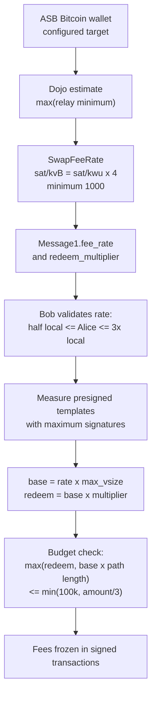

# Bitcoin Fee Selection

This document covers the Bitcoin miner fees paid by swap transactions. It does not cover the Automated Swap Backend's percentage Rate Fee, which is a separate market spread.

Status: current code as of 2026-11-05 (integer lock-rate matching, `estimate_v5_lock_policy_fee`; cancel/refund/punish at raw `base` for cross-client parity). New buys and the bundled ASB use swap-setup `5.0.0`; legacy `1.0.0` is recovery-only and available only in `--no-default-features` builds. Every new swap-setup fee path uses the paired Dojo. There is no Electrum fee-estimation fallback. Broadcast first tries the paired Dojo and then Electrum with the same signed bytes.

## Current: swap-setup 5.0

### Short version

```text
Alice advertises one rate in Message1
  -> Bob measures the largest presigned transaction template
  -> base fee = rate x measured max vsize
  -> redeem = base x redeem_multiplier (Outpost ASB advertises 2.0x; protocol default 2.5x)
  -> cancel/refund/early refund/punish/partial refund/reclaim/withhold/mercy = base
  -> lock is priced from the 485-WU policy weight and the local/Alice integer-ceiled 1.25x rate
  -> fee is frozen at setup; no same-transaction fee bump and no CPFP
     (v5 redeem may replace an unconfirmed cancel; see below)
```

- Alice's rate is the ASB wallet's configured Dojo estimate, including the relay minimum, converted to sat/kvB and raised to at least **1 sat/vB**.
- Bob validates Alice's rate against his own local limits: at least half and at most 3x his local estimate. This protects the buyer from a seller inflating the presigned fees. When a seller asks more than 3x (a cautious estimator on a quiet chain can, for example 6.1 sat/vB while 1-2 sat/vB confirms in the next block), the swap stops before anything is locked and the app shows the seller's rate, the network rate and what it would cost on a failed swap, including the worst case (the longest refund path, four transactions, in sats and as a share of the swap). The user may **accept that rate for one retry with that seller**: the upper limit is raised to the asked rate + 10% for that one swap only and is not saved. A successful swap costs the buyer nothing extra at the higher rate (the redeem fee is paid out of the seller's Bitcoin); only the cancel/refund path does. A rate below half our estimate is never accepted. (`src/seller_fee.rs`, `SellerFeeAllowance`; matrix S-01.)
- The whole spending-path budget is `min(100,000 sats, btc_amount / 3)`.
- Alice accepts a lock fee at least half of the rate she advertised, scaled by the lock's actual measured weight. The internal wallet's flat 1,000-sat absolute minimum is not used.

### Cross-client parity (mandatory)

- `Message1.fee_rate` is the maker's advertised rate; both clients derive every presigned fee from that same number. Dojo supplies it only when our ASB is the maker. When an Eigenwallet ASB is the maker, its estimator supplies it; our Dojo then only bounds-checks the rate and prices the lock.
- Cancel, full refund, early refund, punish, partial refund, reclaim, withhold, and mercy must equal `base` on both sides. The multipliers are compiled into each client, not sent on the wire; `Message3`/`Message4` signatures cover the exact transaction bytes, so any local multiplier rejects the swap before BTC is locked.
- Redeem is compatible because the advertised multiplier (2.0× for Outpost) is sent in `Message1`.
- The lock is buyer-local: only the seller's floor check is protocol-visible.
- The lock's integer rounding is upstream v5 behavior, not an Outpost-local multiplier: the vendored Bob machine derives Alice's floor as `ceil(ceil(advertised sat/vB) × 1.25)` in `protocol-v5/swap-machine/src/bob/mod.rs`; Outpost's `estimate_v5_lock_policy_fee` mirrors it so the input reservation matches.
- The 2026-11-05 local changes — testnet `bitcoin_lock_confirmed_timeout` 12 h (`swap/src/env.rs`) and Bob's early-refund detection (`swap/src/protocol_v5/bob.rs`) — do not change any wire message, timelock, or presigned fee derivation. The vendored `swap-core`/`swap-machine` fee code is unchanged.
- Pairing matrix: Outpost↔Outpost, Outpost↔Eigenwallet, and Eigenwallet↔Outpost all match with raw `base` (the cross-client pairs are not yet heavily tested). Old Outpost builds that still contain the §341 buffers must not be paired with current or Eigenwallet builds.

### Residual risk (accepted, upstream parity)

- The cancel input's `nSequence` is the cancel timelock, so it signals BIP-125 replaceability, but the cancel is a pre-signed 2-of-2 transaction with a frozen fee: neither side can bump it unilaterally, and the retry loop only rebroadcasts identical bytes. The practical RBF case is Alice's redeem (2.0× for Outpost) replacing an unconfirmed cancel; on the failure path there is no unilateral fee escape.
- The full/early refund input is final-sequence and cannot be bumped. A multi-hour fee spike between setup and refund broadcast can strand it until fees fall. This is the same risk every Eigenwallet v5 user accepts; it only affects the failure path.
- Possible future mitigations, both requiring more than a constant change: CPFP on the refund output (Bob owns it, no counterparty cooperation), or a negotiated refund-fee band/re-anchor at broadcast (protocol change).

### Selection



The ASB wallet's target block is configurable: the built-in defaults are **1 on testnet** and **3 on mainnet**. The buyer's wallet uses target **2** for its own local lock estimates. The two sides do not have to use the same target; Bob derives his floor from Alice's advertised rate.

The seller's XMR/BTC ask price comes from **MoneroPriceNow.com**'s public XMR/BTC API by default; Feather Wallet's ticker websocket and Kraken's REST ticker are automatic fallbacks. A configured manual rate bypasses the market source and the Rate Fee spread.

Dojo is required for every new Outpost swap setup and the ASB. The decrypted Dojo URL and API key cross the Java/Rust boundary in the swap/resume request (client), or for the ASB the URL in `OUTPOST_DOJO_URL` and the API key over stdin after the seed (an ASB started by hand may still use `OUTPOST_DOJO_API_KEY`); Rust never reads ciphertext from disk. A cold estimator is retried for up to 60 seconds and requests are deduplicated for 30 seconds per setup. A successful response with no usable confidence key is treated as retryable: the estimator makes up to three fresh Dojo requests before aborting. It never substitutes an older cached map. If Dojo still fails, setup aborts. Withdraw uses the same estimator but offers a manual sat/vB entry instead of Electrum; it does not use the swap buffers or the swap path budget. Its broadcast path is Dojo `pushTx` (`SwapsWallet.broadcastWithdraw`); there is no Electrum fallback for a withdrawal push.

### Fee calculation

For a swap, Bob measures every presigned transaction template with the actual shared output script, the actual refund/punish/redeem output scripts, and **two maximum-size DER signatures plus the actual 2-of-2 witness script**. The largest template is currently 181 vB (the cancel transaction); the partial-refund template is 180 vB and redeem/refund/punish are smaller.

```text
rate            = SwapFeeRate in sat/kvB (>= 1000, i.e. >= 1 sat/vB)
max_vsize       = largest signed presigned template
base            = ceil(rate * max_vsize / 1000)
redeem          = ceil(base * redeem_multiplier / 100)
redeem_multiplier = 200..400, default 250 (2.50x) upstream; Outpost ASB advertises 200 (2.00x)
path_budget     = min(100_000 sats, btc_amount / 3)
```

Bob assigns:

| Transaction | Fee | Notes |
|---|---|---|
| Redeem | `redeem` | 2.0x `base` from the Outpost ASB (2.5x upstream default); at least 2x so it can replace an unconfirmed cancel |
| Cancel | `base` | Starts the refund clock |
| Full refund / early refund | `base` | One fee each |
| Punish | `base` | Alice's recovery transaction |
| Partial refund | `base` | Only when an anti-spam deposit is present |
| Reclaim | `base` | Partial-refund recovery path |
| Withhold | `base` | Anti-spam recovery path |
| Mercy | `base` | Anti-spam recovery path |

The budget check is on the most expensive path: `max(redeem, base x 2)` without a deposit and `max(redeem, base x 4)` with a deposit. Every path must also leave non-dust outputs; otherwise setup is rejected before BTC is locked. There is no separate 20% per-transaction cap in v5.

The relay minimum is part of Alice's advertised rate before it reaches Bob. Fees use integer rounding up, so a non-integral rate cannot round down to zero.

The wallet's generic recommended-fee path also applies a flat `MIN_ABSOLUTE_TX_FEE = 1000 sats` bound (`xmr-btc-swap/bitcoin-wallet/src/wallet.rs`). Swap fees deliberately bypass it, so setup can log `Recommended fee rate is below the absolute minimum relay fee. Falling back to: 1000 sats` while the lock is actually priced at 243 sats. That warning is not a 1,000-sat lock reserve and does not feed the lock policy.

The Outpost ASB currently hardcodes the protocol-minimum 2.0×; upstream Eigenwallet exposes `maker.btc_redeem_base_fee_multiplier` (default 2.50, range 2.00–4.00). The value is carried in `Message1`, so changing it does not break cross-client swaps.

### Worked examples

Current policy, 100,000-sat deposit. `base = ceil(advertised rate × 181 vB / 1000)`; lock rate is `ceil(ceil(advertised rate) × 1.25)` whole sat/vB × 485 WU.

#### At 1 sat/vB (testnet relay floor)

`base = 181 sats`; lock rate = `ceil(1 × 1.25) = 2 sat/vB`.

| Transaction | Calculation | Fee |
|---|---|---:|
| Lock | 2 sat/vB × 485 WU = 243, raised to the 500-sat minimum | 500 sats |
| Redeem | 2.0 × 181 | 362 sats |
| Cancel | base | 181 sats |
| Full refund / early refund | base | 181 sats |
| Punish | base | 181 sats |
| Partial refund / reclaim / withhold / mercy | base each | 181 sats |

#### At 10 sat/vB

`base = 1,810 sats`; lock rate = `ceil(10 × 1.25) = 13 sat/vB`.

| Transaction | Calculation | Fee |
|---|---|---:|
| Lock | 13 sat/vB × 485 WU | 1,577 sats |
| Redeem | 2.0 × 1,810 | 3,620 sats |
| Cancel | base | 1,810 sats |
| Full refund / early refund | base | 1,810 sats |
| Punish | base | 1,810 sats |
| Partial refund / reclaim / withhold / mercy | base each | 1,810 sats |

#### Lock fee

The lock is the one transaction Bob funds from his wallet, so it is priced separately:

```text
local_rate      = ceil(max(fee_rate_at(target 2), fee_rate_at(target 1)) in sat/vB)
bob_lock_rate   = ceil(local_rate x 1.25)
alice_lock_rate = ceil(ceil(Alice-advertised rate in sat/vB) x 1.25)
lock_rate       = max(bob_lock_rate, alice_lock_rate)   # whole sat/vB
lock_fee        = max(lock_rate x 485-WU v5 lock weight, 500 sats)
```

**The 500-sat minimum (cross-client).** An Eigenwallet 5.0.2 maker accepts a lock only if it pays at least half of its own estimate, and that estimate comes from its wallet's `estimate_fee`, which never goes below a flat 1,000 sats. So on a quiet chain an Eigenwallet maker rejects any lock below 500 sats (seen live on testnet: `Transaction fee is too low compared to our estimate (364 sats vs 1000 sats)`). The buyer therefore pays `max(Dojo-based lock fee, 500 sats)`. This only matters below about 4 sat/vB (121 vB × 4 ≈ 500); above that the Dojo-based fee is higher and is used as is. The Outpost maker has no flat floor and accepts smaller locks (see below), so Outpost-to-Outpost swaps lose nothing; the minimum only makes an Outpost buyer acceptable to every maker. `V5_LOCK_FEE_MIN_FOR_ANY_MAKER` in `xmr-btc-swap/swap/src/bitcoin/wallet.rs`.

The rate is matched in **whole sat/vB** because the vendored v5 Bob machine derives
Alice's floor the same integer way (`protocol-v5/swap-machine/src/bob/mod.rs`:
`ceil(alice_estimated_sat_per_vb) x 1.25`, then `ceil`). Bob reserving fractionally —
152 sats on this 485-WU weight, or the legacy 154 — is below the 243-sat floor and fails
`bob_make_psbt` input selection. At the 1 sat/vB testnet relay floor this yields
`ceil(1 x 1.25) = 2` sat/vB and 243 sats (122 vB effective, logged as ~1.99 sat/vB).
The premium is quantized: 2x at a 1 sat/vB base, 1.5x at 2, 1.33x at 3, and exactly
1.25x at 4 (and every multiple of 4). `1.25x` and `1.5x` are indistinguishable at
1-2 sat/vB because both round to the same whole sat/vB; v5 has no separate 1.5x
constant (the only compiled v5 multiplier is the 1.25x lock buffer; the 2.0x redeem
multiplier is advertised in `Message1`, and cancel/refund/punish are raw `base`).
Bob constructs the lock with this fixed policy fee; `V5_BOB_LOCK_PUBLISHED` records the
actual PSBT weight, fee, and effective sat/vB, so any dilution from a change output is
visible. `max_giveable_v5` reserves the same policy fee, not the internal wallet's flat
1,000-sat minimum; a max-amount swap therefore spends the usable balance (99,500 of
100,000 sats at the 500-sat minimum) instead of leaving an accidental change output.

Alice checks the received lock against **half of the rate she advertised in `Message1.fee_rate`**, scaled by the actual lock PSBT weight. That floor is itself capped at 20% of the swap amount and 100,000 sats, and it never applies the internal wallet's flat 1,000-sat minimum. Bob's lock rate is `max(local, ceil(ceil(advertised) × 1.25))` whole sat/vB — 2x the
advertised rate at a 1 sat/vB base, 1.5x at 2, 1.33x at 3, and 1.25x at 4 — always at
or above Alice's 0.5x floor.

### Who pays which fee

| Transaction | Broadcast by | Fee basis | When paid |
|---|---|---|---|
| Lock | Bob | integer ceil of 1.25x local/Alice rate on the 485-WU policy weight, at least 500 sats so any maker accepts it | Happy path |
| Redeem | Alice | base x redeem multiplier (2.0x Outpost; 2.5x upstream default) | Happy path |
| Cancel | Bob | base | Failure path |
| Full refund / early refund | Bob | base | Failure path |
| Punish | Alice | base | Failure path |
| Partial refund / reclaim / withhold / mercy | Bob or Alice as applicable | base | Anti-spam failure path |

The displayed "Pays" role describes who broadcasts the transaction. The fee is deducted from the locked BTC output, as with every presigned spending path.

### Why fees cannot be changed later

Every recovery transaction spends the shared `and_v(pk(A), pk(B))` output and requires both parties' signatures. Those signatures are exchanged during setup and commit to the exact transaction, including its fee. Re-pricing later would invalidate the pre-exchanged signature and require live counterparty cooperation. The same transaction is never fee-bumped later, and CPFP is not available for these presigned transactions.

One RBF case is intentional in v5: the cancel transaction signals RBF, and redeem is priced at least 2× the base fee so it can replace an unconfirmed cancel. That changes which transaction confirms; it does not change the redeem transaction’s own fee or txid. Bob derives the XMR sweep key from the exact redeem transaction, so the redeem txid must stay stable.

### Audit notes and tests

- The v5 fee model was verified against the pre-v5 snapshot: `max_giveable` used to reserve the **same policy fee** as the lock (`sent - estimate_lock_fee`), which is why old max swaps produced no change. The inner BDK wallet's flat 1,000-sat reserve was the regression.
- `swap-core` tests pin the measured template maximum, the base fee covering every presigned path, the redeem multiplier encoding, path budgets, dust checks, and the 1 sat/vB minimum rate.
- `swap-machine` tests pin the lock floor at 1 sat/vB (61-sat floor for 122 vB, not 500). The lock fee is fixed before Alice's signatures and deliberately **not** rebuilt from actual weight: a rebuild changes the lock txid and invalidates Alice's `TxCancel` signature (`protocol-v5/swap-machine/src/bob/mod.rs`).
- `swap` tests pin `max_giveable_v5` at 99,500 sats for a 100,000-sat deposit (the 243-sat policy fee lifted to the 500-sat minimum), and check the lifted fee against Eigenwallet's original maker floor at 1-3 sat/vB (`the_lifted_lock_fee_passes_the_eigenwallet_maker_floor`).
- Logs: `V5_MAKER_FEE_SNAPSHOT`, `V5_BOB_FEE_ESTIMATE` (wallet helper), `V5_BOB_FEE_ESTIMATED` (buy path), `V5_BOB_LOCK_FEE_SELECTED`, `V5_BOB_LOCK_PUBLISHED` (actual weight/fee/effective sat/vB).
- `max_giveable` and swap setup call the same `Wallet::estimate_lock_policy_fee` function. A separate fee calculation in `buy_xmr_v5` once reserved 154 sats while setup selected 243; do not reintroduce it.
- **Cross-client parity (2026-11-05):** the §341 cancel 1.5×/refund 2.0× buffers were removed; cancel, full refund, early refund, punish, partial refund, reclaim, withhold, and mercy all use `base`. The derivation is compiled into each client, not sent on the wire, so a local multiplier fails `Message4` signature verification. Earlier Outpost builds containing the buffers must not be paired with current or Eigenwallet builds.
- **Redeem (2026-11-05):** the ASB advertises the protocol minimum 2.0× (upstream default 2.5×) via `swap/src/asb/v5_quote.rs`; redeem remains valid for RBF replacement of an unconfirmed cancel.
- **No unilateral fee bump:** cancel/refund/punish constructions reuse the setup-frozen fee and the retry loop rebroadcasts identical bytes. BIP-125 on the cancel only enables a different transaction (redeem) to replace it; the failure-path risk is documented under "Residual risk".

## Legacy: swap-setup 1.0

Legacy swaps are recovery-only and are used only by `--no-default-features` builds. Their fee policy is different and is **not** the current v5 policy:

- Lock/redeem use target 2 with a 1.25x buffer.
- Bob cancels/refunds use target 2 with a 2x buffer; Bob's older binary path uses target 1.
- Alice punish uses target 6 with a 2x buffer.
- Alice's cancel/refund snapshot uses target 1 and is only a sanity floor.
- Every fee is capped at `min(20% of the amount, 100,000 sats)`.
- Alice accepts Bob's cancel/refund proposals only within 50% to 300% of her snapshot.
- Bob refuses a new swap if the two failure-path fees together exceed 20% of the BTC amount.
- The relay floor is scaled by vsize; the old flat 1250-sat behavior is fixed.
- `max_giveable` reserves the same lock policy fee, matching the pre-v5 behavior.

Legacy fee estimates are implemented in `xmr-btc-swap/swap/src/bitcoin/wallet.rs` and `src/swap_state_manager.rs`.

## Legacy vs v5 fee alignment (1 sat/vB testnet floor, 100,000-sat deposit)

Realigned 2026-11-05 after live swap `c365206b` — use this table to spot any
future drift between the two engines.

| Transaction | Legacy basis | Legacy fee @1 sat/vB | V5 basis | V5 fee @1 sat/vB | Δ |
|---|---|---:|---|---:|---|
| Lock | 123 vB × rate × 1.25 (target 2) | 154 | integer `ceil(ceil(rate)×1.25)` × 485 WU (122 vB) = 243, raised to the 500-sat cross-client minimum | 500 | **+346** — an Eigenwallet maker rejects locks below 500 sats |
| Redeem | 140 vB × rate × 1.25 | 175 | `base × 2.0` (frozen, RBF-replaces cancel) | 362 | **+187** — minimum multiplier that still outbids the cancel |
| Cancel | 150 vB × rate × **2.0** | 300 | `base` (frozen) | 181 | **−119** — upstream parity; a local multiplier breaks cross-client Message4 verification |
| Full refund | 140 vB × rate × **2.0** | 280 | `base` (frozen) | 181 | **−99** — upstream parity; refund cannot self-bump (accepted upstream risk) |
| Punish | 140 vB × rate × 2.0 (target 6) | 280 | `base` frozen | 181 | **−99** — Alice-side tx, same buffer drop |
| Partial refund / reclaim / withhold / mercy | n/a (legacy had none) | — | `base` frozen (anti-spam-deposit paths) | 181 | new in v5 |

### Legacy comparison at 10 sat/vB

Same 100,000-sat deposit, advertised rate 10 sat/vB. `base = 10 × 181 = 1,810 sats`; lock rate `ceil(10 × 1.25) = 13 sat/vB`.

| Transaction | Legacy @10 sat/vB | V5 @10 sat/vB | Δ |
|---|---:|---:|---|
| Lock | 123 vB × 10 × 1.25 = 1,538 | 13 sat/vB × 485 WU = 1,577 | **+39** — integer floor match |
| Redeem | 140 vB × 10 × 1.25 = 1,750 | `2.0 × 1,810` = 3,620 | **+1,870** — protocol-minimum RBF multiplier |
| Cancel | 150 vB × 10 × 2.0 = 3,000 | `base` = 1,810 | **−1,190** — upstream parity |
| Full refund / early refund | 140 vB × 10 × 2.0 = 2,800 | `base` = 1,810 | **−990** — upstream parity |
| Punish | 140 vB × 10 × 2.0 = 2,800 | `base` = 1,810 | **−990** — upstream parity |
| Partial refund / reclaim / withhold / mercy | n/a | `base` = 1,810 each | new in v5 |

Legacy values above use the legacy 123/140/150 vB templates and its 1.25×/2.0× multipliers; v5 uses the measured 181-vB maximum template for every `base` fee. Current-policy examples at 1 and 10 sat/vB are in "Worked examples" above.

**Deliberate v5 differences (updated 2026-11-05, per-tx buffers implemented in §341
and removed the same day for upstream parity):**

- Lock pays *more*: integer matching to Alice's maker floor (`ceil(ceil(rate)×1.25)` = 2 sat/vB at the floor) — underpaying fails setup input selection. Passes Eigenwallet's floor check (their floor = 50% of advertised rate × weight).
- Redeem pays *more*: 2.0× base (the protocol minimum) still lets it RBF-replace an unconfirmed cancel; upstream defaults to 2.5×.
- **Cancel/refund/punish = raw `base` (upstream parity).** The derivation formula lives in each client's code, not on the wire, so a local multiplier fails `Message4` signature verification on every cross-client swap. Old Outpost builds that still contain the §341 buffers must not be paired with new or Eigenwallet builds; current builds are upstream-compatible. The refund txid is surfaced in the swap log ("Refund transaction published: …").

### Reconciling the dropped buffers with Dojo's next-block estimate

**REVERTED 2026-11-05 (upstream parity):** the per-tx split (cancel 1.5×,
refund 2.0×) was implemented in §341 and removed the same day. The derivation
formula is compiled into each client, not sent on the wire, so any local
multiplier makes our cancel/refund transactions differ from Eigenwallet's and
`Message4` signature verification fails on every cross-client swap. Cancel,
full refund, early refund, and punish therefore all use the raw `base` fee,
matching upstream and every other v5 client.

Consequence: the refund does not self-bump (final `nSequence`) and a fee spike
between setup and refund broadcast can strand it. That is the same risk every
Eigenwallet user accepts. The cancel remains BIP-125 replaceable, so a cancel
spike is recoverable through the retry loop. Future insurance must be a
negotiated wire capability (both peers advertise a multiplier and fall back to
`base`), never a compiled constant.

Historical context (for future fee archaeology): everything is priced from the
Dojo **next-block** estimate at setup, but failure-path transactions broadcast
long after setup: the cancel waits out its timelock (mainnet 30 blocks ≈ 5 h;
testnet 42 blocks), and the refund broadcasts after that. Options considered:

1. **RBF is only an escape through the redeem path (current design).** The cancel
   input's `nSequence` is the cancel timelock, which signals BIP-125 replaceability,
   but cancel/refund are pre-signed 2-of-2 transactions whose fee is frozen: neither
   side can bump them unilaterally, and the retry loop rebroadcasts identical bytes.
   The intended RBF case is Alice's redeem (2.0× for Outpost) replacing an unconfirmed cancel.
   The refund input is final (`0xFFFFFFFF`), so it cannot bump at all.
2. **Re-anchor the refund fee at broadcast time (possible future addition).**
   Re-estimate at refund-broadcast time and require the *maker* to pre-authorize a
   fee band. Needs a protocol-level change (both sides must agree on the spend
   signature semantics), so it remains a migration task, not a quick patch.

**Common invariants:** relay floor ≥1 sat/vB applies before everything; fees are frozen at setup in the pre-signed transactions (no RBF on the same tx, no CPFP); budgets checked at setup (`min(100k, amount/3)` path cap).

## Code map

- v5 rate and fee limits: `xmr-btc-swap/protocol-v5/swap-core/src/bitcoin/fees.rs` (`SwapFeeRate`, `RedeemFeeMultiplier`, `SwapFeeInputs::calculate`)
- v5 ASB snapshot: `xmr-btc-swap/swap/src/asb/v5_quote.rs` (`V5SnapshotProvider`)
- v5 Bob fee assignment: `xmr-btc-swap/protocol-v5/swap-machine/src/bob/mod.rs`
- v5 Alice-derived lock floor: same file (`ceil(ceil(advertised sat/vB) × 1.25)`); Outpost mirror in `xmr-btc-swap/swap/src/bitcoin/wallet.rs` (`estimate_v5_lock_policy_fee`, `max_giveable_v5`)
- Generic 1,000-sat recommended-fee bound (not used for swap fees): `xmr-btc-swap/bitcoin-wallet/src/wallet.rs` (`MIN_ABSOLUTE_TX_FEE`)
- Withdraw broadcast (Dojo `pushTx`, no Electrum fallback): `app/src/main/java/swap/wallet/SwapsWallet.java` (`broadcastWithdraw`)
- v5 Alice lock floor: `xmr-btc-swap/protocol-v5/swap-p2p/src/protocols/swap_setup/alice.rs`
- v5 lock-fee floor helper: `xmr-btc-swap/protocol-v5/swap-machine/src/common/mod.rs`
- v5 Dojo client and retry/dedupe: `xmr-btc-swap/bitcoin-wallet/src/dojo.rs`
- Legacy Dojo client and retry/dedupe: `xmr-btc-swap/swap/src/bitcoin/fee_estimator.rs`
- Dojo-first broadcast: `xmr-btc-swap/swap/src/bitcoin/wallet.rs`
- Pre-v5/legacy fee policy: `src/swap_state_manager.rs`, `xmr-btc-swap/swap/src/bitcoin/wallet.rs`
- Integration tests: `xmr-btc-swap/swap/tests/dojo_fee_estimator.rs`
