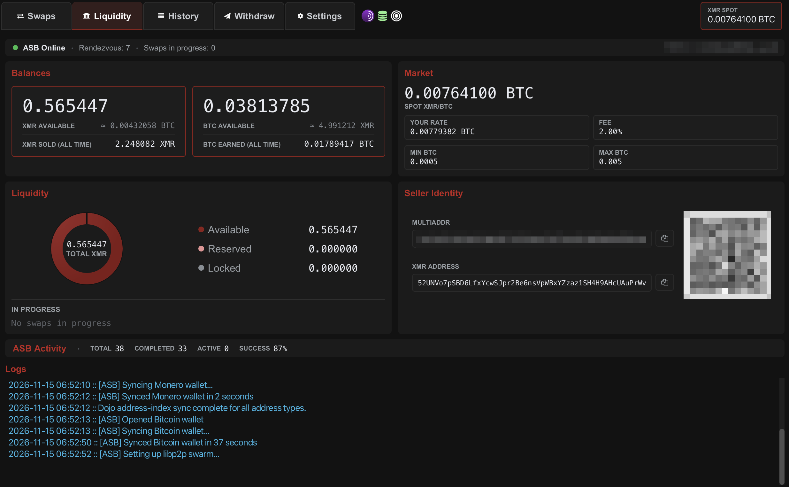

# Selling XMR

Run an Automated Swap Backend (ASB) to sell XMR for BTC. The ASB advertises your offer, locks XMR during a swap, and receives BTC when the buyer completes the trade. It runs inside Outpost and only while the application is open.

## Contents

- [Before you start](#before-you-start)
- [Start the ASB](#start-the-asb)
- [Liquidity page](#liquidity-page)
- [Balances and market](#balances-and-market)
- [ASB activity](#asb-activity)
- [XMR liquidity and fee reserve](#xmr-liquidity-and-fee-reserve)
- [Deposit XMR](#deposit-xmr)
- [Seller identity](#seller-identity)
- [ASB wallets and seeds](#asb-wallets-and-seeds)
- [ASB settings](#asb-settings)
- [Auto Tx0](#auto-tx0)
- [Staying online](#staying-online)

## Documentation

- [Buying XMR](BUY_XMR.md)
- [Withdrawing BTC](WITHDRAW.md)
- [Fees](FEES.md)
- [Settings](SETTINGS.md)
- [Swap architecture](ATOMIC_SWAPS.md)
- [Privacy and network routing](PRIVACY.md)
- [Security model](SECURITY.md)
- [Rendezvous points](RENDEZVOUS.md)
- [FAQ](FAQ.md)

## Before you start

- Pair Outpost with [Ashigaru Wallet](https://ashigaru.rs) and a Dojo backend. See [Buying XMR](BUY_XMR.md) for pairing.
- Deposit XMR into the ASB wallet before advertising a meaningful maximum. Only unlocked XMR can back an offer.
- Keep the app, Tor, Dojo, and your Monero daemon running while the ASB is online.
- Protocol 5 needs the Monero daemon RPC (not only wallet-RPC) for output scanning. The app passes its existing Monero daemon/forwarder endpoint into the ASB automatically; `monero.daemon_url` exists only as an override for custom/CLI setups.
- The ASB has its own Monero wallet and `SWAPS_ASB` Bitcoin account. Its balance is not the Ashigaru `DEPOSIT` balance.
- Who can buy from you: other Outpost users, Eigenwallet buyers (compatible, not yet heavily tested), and [Ashigaru Desktop](https://github.com/linkinparkrulz/ashigaru-desktop)'s upcoming swap feature (built to work, not yet tested). See [Client compatibility](ATOMIC_SWAPS.md#client-compatibility).

## Start the ASB

Tick **Start selling Monero** when you unlock (or **Also start the ASB** when you connect), or press **Start ASB** on the Liquidity page of the running app (no restart needed). Outpost starts the ASB in the background, and the Liquidity page shows a progress indicator while the wallets initialize and sync.

**The first start on a new install is slow, once.** The ASB's Monero wallet is new, and its first sync has to catch up with the whole chain over Tor: expect 10 minutes or more (measured 7 to 11 minutes on stagenet, and longer when the Monero node is slow. Mainnet is still to be measured.). The Liquidity page and the swap log say how long it has been syncing, once a minute. Later starts take seconds. If the ASB's Bitcoin wallet then stays on "Syncing", its Electrum server may not be answering over Tor: test it, or pick another, in Settings → Electrum.

If the ASB is not running, the Liquidity page shows an offline panel with the **Start ASB** button.

The Liquidity page shows a spinner while the ASB initializes. Once it is initialized, the top-bar ASB indicator shows **ASB Running** or **ASB Listed**:

- **ASB Running** — the ASB is initialized but was not seen in its own seller-list refresh.
- **ASB Listed** — the ASB was found in the seller list and is discoverable.

When the ASB is stopped, the indicator is hidden and Liquidity shows the offline panel.

## Liquidity page

The **Liquidity** page is the ASB dashboard. It contains the status strip, balances, market card, liquidity donut, seller identity, and ASB activity strip.

The **status strip** at the top shows whether the ASB is online, how many rendezvous points it is registered with, **Swaps in progress** (orange while any are running; hover for each swap and its current step), and the ASB's **PEER ID**.

## Balances and market

The **Balances** card shows:

- **XMR AVAILABLE** — the Monero wallet's unlocked balance, with its BTC equivalent.
- **BTC AVAILABLE** — the ASB's own Bitcoin balance (the `SWAPS_ASB` account), with its XMR equivalent.

Under each balance is an all-time total, kept across restarts with each swap counted once: **XMR SOLD**, the Monero the ASB has sold, and **BTC EARNED**, the Bitcoin its redeems paid it (before the cost of the Monero it sent).

The **Market** card shows the current spot XMR/BTC price, your advertised rate, the FEE percentage, and the current MIN BTC and MAX BTC quote. The default spot source is **MoneroPriceNow.com**'s public XMR/BTC API, with Feather Wallet's ticker websocket and Kraken's REST ticker as automatic fallbacks; a manual rate bypasses the market source. MIN BTC and MAX BTC are the live advertised values, not necessarily the raw Settings values: MAX BTC can fall below your configured maximum when available XMR is low.

- The BTC balance comes from Dojo over Tor. It shows `—` while Dojo is unreachable.
- The XMR balance comes from the ASB's Monero wallet and daemon.
- To withdraw earned BTC, use [Withdrawing BTC](WITHDRAW.md) and select `SWAPS_ASB` as the source.

See [Bitcoin accounts used by swaps](../README.md#bitcoin-accounts-used-by-swaps) for derivation paths.

## ASB activity

The **ASB Activity** strip summarizes the swaps shown on the History page:

- **TOTAL** — ASB swaps in History.
- **COMPLETED** — swaps that reached BTC redeemed or punished.
- **ACTIVE** — swaps with BTC or XMR currently locked.
- **SUCCESS** — completed share of settled swaps.

Use History for the full swap table and status breakdown.

## XMR liquidity and fee reserve

The **Liquidity** card splits the ASB's XMR into:

- **Available** — unlocked XMR not reserved by an in-flight swap. This is the balance available to back new quotes.
- **Reserved** — XMR promised to swaps that are still in progress. It is released when the swap reaches a terminal state.
- **Locked** — XMR locked by the Monero wallet while transactions are in progress.

Under these, **In progress** lists the ASB swaps that are running now, newest first: the start of each swap ID and its current step, for example `f4f60ea0…  XMR confirming`. The card has room for one line, so with several swaps the newest shows and a **+N more** link opens a window listing all of them. The steps run Setup, BTC lock seen, BTC locked, XMR lock sent, XMR confirming (the Monero lock is confirming and the buyer is checking it), Buyer signed, Redeeming BTC, then Redeemed.

Quote sizing also leaves a fixed **0.003 XMR fee reserve** for the Monero lock-transfer fee. The reserve is a safety margin, not an extra fee, and any part not used by the real fee remains spendable. It is applied before an offer is advertised and again before the XMR lock, so an underfunded ASB refuses the swap before the buyer locks BTC.

The `Reserved` figure is mirrored from ASB liquidity events for the dashboard. If the ASB restarts, it re-reserves liquidity from persisted swaps.

## Deposit XMR

The **Seller Identity** card shows the ASB's XMR address and a QR code. Send XMR there, then wait for the balance to become unlocked before expecting the advertised maximum to rise.

Only send XMR to this address. It is the ASB wallet address, not an Ashigaru Bitcoin address.

## Seller identity

The **Seller Identity** card shows:

- **MULTIADDR** — the public seller multiaddr used to dial the ASB, with a copy button.
- **XMR ADDRESS** — the ASB deposit address, with a copy button and QR code.

The status strip also shows a shortened peer ID; hover it for the full value. It also shows the number of configured rendezvous peers. The ASB registers with those peers through [Settings](SETTINGS.md), and buyers use the seller list to find the offer. See [Rendezvous points](RENDEZVOUS.md).

The multiaddr and peer ID are public identifiers, not wallet secrets.

## ASB wallets and seeds

The ASB uses two wallet identities:

- **Bitcoin:** the ASB Bitcoin wallet is derived from the paired root seed. When the GUI starts the ASB, it passes that seed through stdin to the `start` command. It does not write a temporary plaintext seed file, and it removes a legacy `asb/<network>/seed.pem` file from older versions. Standalone ASB operation continues to use its normal persistent seed file.
- **Monero:** the `asb-wallet` has its own 25-word seed. It is not the Ashigaru seed.

To back up the Monero wallet, open **Settings → Wallet → XMR ASB Seed → Show Seed** while the ASB is running. Write the 25 words down and keep them offline; anyone with them can spend the ASB's Monero. If the ASB wallet files are lost, restore the XMR with those words in any Monero wallet.

Protect the machine and the app data directory; they contain wallet material.

## ASB settings

Configure the ASB from the [Settings](SETTINGS.md) page:

- **Min and max:** the minimum and maximum BTC quote sizes.
- **Rate Fee:** the percentage spread added to the market price.
- **Manual rate:** a fixed BTC-per-XMR price. While set, the ticker is bypassed, the Rate Fee is inactive, and the FEE chip shows the effective markup over spot. Leave it empty to track the market plus Rate Fee.
- Without a manual rate, the ASB stops quoting if no price source delivers an update for more than 15 minutes.

Applying ASB settings restarts the running ASB so the new values take effect.

## Auto Tx0

Auto Tx0 is optional and off by default. When enabled, new BTC deposits in the `SWAPS_ASB` account are automatically Tx0'd into a Whirlpool coinjoin using the pool size selected in Settings. The current selector offers `0.025 BTC` and `0.25 BTC`; if that pool is not eligible, the mixer falls back to the largest eligible pool.

> **Coordinator and partner ID:** Auto Tx0 uses the Ashigaru Whirlpool coordinator. The coordinator accepts only partner IDs it has registered, so for now Outpost sends Ashigaru's (`ashigaruterminal`), which credits Ashigaru's partner share. Auto Tx0 has not been field-tested on mainnet yet: leave it off unless you are testing with small amounts. Each Tx0 pays the coordinator's pool fee, 5% of the pool size at the time of writing (125,000 sat for the 0.025 BTC pool, 1,250,000 sat for the 0.25 BTC pool).

> **Privacy caution:** Auto Tx0 may combine UTXOs to meet the pool-size threshold, which can link their ownership.

Auto Tx0 works on mainnet only, since no public Whirlpool coordinator runs on testnet. Auto Tx0 requires a Dojo connection and runs only while the ASB is running. It is best-effort and has not been heavily tested. It does not change swap pricing or the swap execution path, and it never blocks a swap if Whirlpool is unavailable.

After Tx0, funds move through Whirlpool's premix/postmix accounts and are no longer reflected in the `BTC · SWAPS_ASB` balance. Use Ashigaru to manage those accounts.

## Staying online

Leave Outpost running while you want to sell. Closing the app stops the ASB and removes the offer from discovery. An **ASB Listed** status means your offer was found during the seller-list refresh; **ASB Running** means the daemon is up but listing has not been confirmed.

Sleep, network loss, Tor failures, Dojo outages, or a Monero daemon failure can take the ASB offline. Monitor the Liquidity page, History, and swap log.

### Running it day and night

Outpost has no command-line seller yet, so the ASB runs inside the desktop app. Outpost does not stop your computer from sleeping, so set that up yourself.

- **A dedicated machine is best.** An old laptop or a small mini PC that stays plugged in, on a stable connection, with Outpost as its only job. Keep a laptop lid open or set it to stay awake with the lid closed.
- **macOS:** run `caffeinate -dimsu` in a Terminal window and leave it open. Or in System Settings → Battery (or Energy) turn on "Prevent automatic sleeping when the display is off" while on power.
- **Windows:** Settings → System → Power, set "Sleep" to Never while plugged in.
- **Linux:** start it with `systemd-inhibit --what=sleep:idle --who=outpost --why=seller outpost`, or turn off automatic suspend in your desktop settings.
- **Turn off automatic restarts.** Operating system updates that reboot overnight take the ASB offline until you unlock the app.
- **After a power cut the app does not start by itself.** It asks for your password, so someone has to unlock it. A small UPS helps.
- **A virtual machine works** if the VM stays running and its own suspend is off. Give it a desktop session, since the app has a window. Qubes works the same way in an ordinary qube (untested here).
- **Whonix is not needed.** Outpost brings its own Tor and sends everything through it. Running it inside a Tor-routed machine would put Tor over Tor and slow it down.
- **Android and Termux are not supported.** Outpost is a desktop app.

For extra isolation on Linux, these limit what the app can touch on the rest of the machine. None of them are tested with Outpost, so check that it still starts and reaches Tor.

- **Firejail:** wraps one app in a restricted sandbox with a single command, for example `firejail --private=$HOME/outpost-home outpost`. The app gets its own home folder, so it cannot read your other files.
- **Bubblewrap (`bwrap`):** the lower-level tool Flatpak is built on. It offers the same kind of isolation, but you write the options yourself.
- **A virtual machine:** the strongest of the three, and the easiest to reason about.

Whatever you choose, leave network access on, because the app needs Tor, Dojo and the Monero node. These tools limit what else on the machine the app can reach and do not protect the ASB wallets if the app itself were compromised.

Treat the ASB wallets as hot wallets. Keep only what you want to sell on the machine, use full-disk encryption, and back up both seeds (see Settings → Wallet).

If the ASB goes offline during a swap, it picks the swap up again when it starts. Timelocks keep running while it is off, so a swap left offline for a long time can end as a refund instead of a sale. Check the Liquidity page after any outage.

A command-line seller for servers is on the roadmap.
