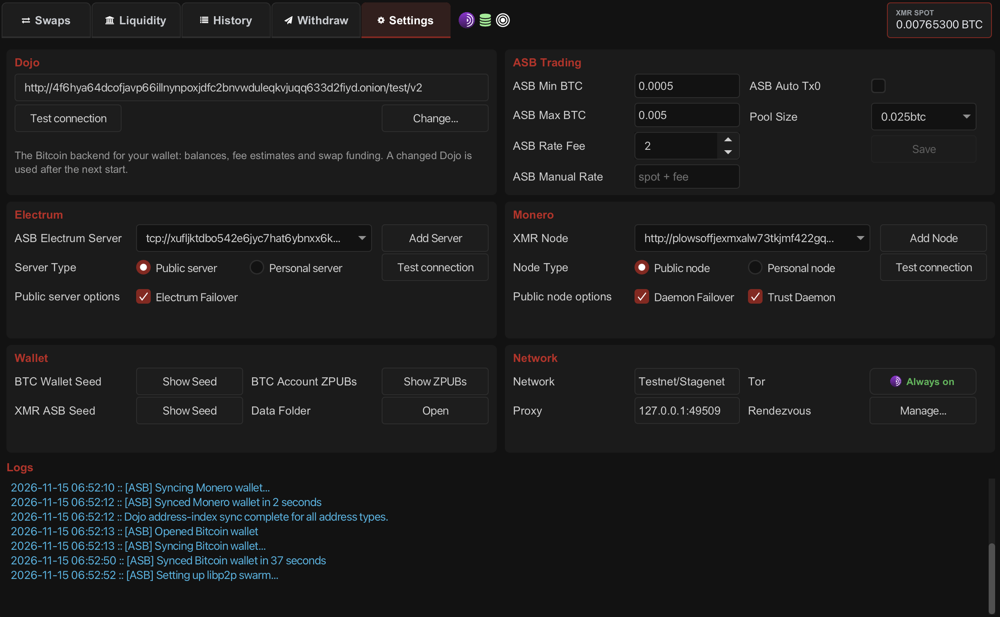

# Settings

Settings has read-only network status plus controls for wallet recovery, Monero and Electrum connectivity, ASB trading, Auto Tx0, and rendezvous peers. Most changes are saved immediately; ASB Trading and Auto Tx0 have their own action buttons.

## Contents

- [Network and Tor](#network-and-tor)
- [Wallet and recovery](#wallet-and-recovery)
- [Monero](#monero)
- [Bitcoin and Electrum](#bitcoin-and-electrum)
- [ASB Trading](#asb-trading)
- [Auto Tx0](#auto-tx0)
- [Rendezvous peers](#rendezvous-peers)

## Documentation

- [Buying XMR](BUY_XMR.md)
- [Selling XMR](SELL_XMR.md)
- [Withdrawing BTC](WITHDRAW.md)
- [Fees](FEES.md)
- [Swap architecture](ATOMIC_SWAPS.md)
- [Privacy and network routing](PRIVACY.md)
- [Security model](SECURITY.md)
- [Rendezvous points](RENDEZVOUS.md)
- [FAQ](FAQ.md)

## Network and Tor

- **Network** is read-only and shows Mainnet or Testnet/Stagenet, from the wallet you connected.
- **Tor** shows **Always on**: it is required and cannot be turned off. There is no clearnet mode. Dojo requests fail closed if the Tor proxy is unavailable.
- **Proxy** is read-only and shows the local Tor SOCKS proxy.

The top-bar Tor icon reports local Tor and hidden-service state; the Dojo icon reports Dojo request status. Tor data and hidden-service keys live in the app data folder. Protect that folder and do not share its private files.

## Wallet and recovery

- **Data Folder → Open** opens the app's data and configuration directory.
- **BTC Wallet Seed → Show Seed** shows the Bitcoin wallet's 12 or 24 words: the wallet you connected, or the one you created in Outpost (where these words and your passphrase are its only backup). It asks for the passphrase you unlock Outpost with first. To restore a wallet that has a BIP39 passphrase you need the words and that passphrase.
- **XMR ASB Seed → Show Seed** reveals the ASB Monero wallet's 25-word seed while the ASB is running, after asking for the passphrase you unlock Outpost with. It is not the Ashigaru or paired root seed. Back it up offline if you sell XMR; anyone with those words can spend the ASB's Monero. See [Selling XMR](SELL_XMR.md#asb-wallets-and-seeds).
- **BTC Account ZPUBs → Show ZPUBs** shows the watch-only account ZPUBs for `SWAPS_DEPOSIT`, `SWAPS_REFUNDS`, and `SWAPS_ASB`. They are recovery/verification metadata, not spending keys.

### Dojo

The **Dojo** tile (top left) shows the Dojo in use. **Test connection** on it logs in to that Dojo through Tor and shows the result next to the button: **Connected** in green, or **Key rejected**, **Can't reach it** or **Unexpected reply**; the same result goes to the swap log. **Change...** switches to another Dojo after the wallet is connected (before, the only way was to reset the app). Choose one of three sources:

- **A public Dojo** from the verified Dojo Bay list (the same list as the connect window, fetched over Tor with every signature checked; the note under the list says whether it is the current list, a saved one or the one that shipped with the app).
- **My own Dojo**: paste its pairing JSON, or enter its URL and API key.
- **An Ashigaru pairing payload** (and that wallet's passphrase): only the Dojo in it is used; your wallet does not change. This is for Ashigaru versions that still have the pairing payload.

**Test connection** logs in to the Dojo through Tor with the key. **Save** only becomes available after the test succeeded, so a wrong key can never replace a working Dojo, and it needs your wallet passphrase (the API key is stored encrypted with it). The new Dojo is used after the next start of the app: the wallet balances and fee estimates set the Dojo up at start, and switching only part of the app would leave it on two Dojos at once.

## Monero

### XMR Node

Choose a configured Monero daemon or use **Add Node** to add one. Selecting a node saves it and restarts the Monero wallet RPC and a running ASB.

**Test connection** checks the selected node over Tor without switching to it: it must answer, be synced, and be on the right network (mainnet, or stagenet for a testnet wallet). The result shows in green or red, with the time it took; a first connection to an onion node can take up to a minute.

### Node Type

Whether a node is yours is a property of **the node**, so the **Node Type** row always describes the node selected above it.

- **Add Node** has a **Personal node** box. Tick it only for a node you run yourself: on mainnet, Outpost then trusts that node alone to confirm a seller's Monero lock, without asking witness nodes, so a node you merely trust is not enough. It starts ticked only for `localhost` and private-network (`192.168.x.x`, `10.x.x.x`, …) addresses. It is never ticked for you for an `.onion`, since most public nodes are onions. Saving selects the new node, and the radio follows.
- In the dropdown your own nodes are marked **(personal)**. A node on `localhost` or a private network always counts as yours.
- Clicking **Personal node** selects the own node you used last; if you have not saved one, the Add Node window opens with the box ticked. Clicking **Public node** selects the public node you used last.
- To switch to a public node while yours is down, click **Public node**. Click **Personal node** to go back; nothing has to be typed again. Each switch restarts the Monero wallet RPC (and a running ASB), as picking a node from the list does.

| | Public node | Personal node |
|---|---|---|
| Daemon Failover | your choice (off by default) | not used: the node is pinned |
| Trust Daemon | your choice (faster sync) | always on |
| Other nodes confirm the seller's lock | yes, on mainnet | no: your node is trusted alone |

With **Personal node** the two options beside **Public node options** are greyed out and shown as pinned and trusted. Your saved choices are kept and come back for a public node. The marked nodes are stored in `atomic-swaps.properties` as `moneroOwnNodes`.

### Daemon Failover (public nodes)

The app reaches Monero daemons through Tor. When the active daemon fails, the local daemon-pool forwarder can switch to the next healthy daemon instead of waiting through the wallet's reconnect backoff.

- **Enabled (off by default; you must turn it on):** the selected daemon is first choice; curated daemons are fallbacks. It switches immediately on dial failure, or after roughly a minute of failed health checks. It also switches away from a daemon that lags behind the pool on block height, and away from one that accepts requests but never answers: two requests in a row with no reply for 75 seconds switch to the next healthy daemon, and the stalling one is skipped for ten minutes. It fails back to your daemon when it becomes healthy again (checked every five minutes), unless it stalled recently.
- **Disabled (default):** the selected daemon is pinned: no other daemon is ever used. If it is down, the wallet waits or errors until it returns; health checks only report.

The switch is saved immediately and takes effect the next time the ASB or a swap starts. A curated default is treated no differently from a daemon you added. Failover is opt-in because a fallback daemon sees your wallet's sync pattern; nothing is added next to your daemon unless you enable it.

### Trust Daemon (public nodes)

Trusting a remote mainnet daemon uses larger sync batches, which is faster over Tor. Outputs and block hashes are still fully verified.

Test networks and localhost daemons are always trusted. A self-hosted remote or onion node counts as remote, so enable this if you want faster sync from it. When enabled, that daemon sees your wallet's sync pattern; it cannot forge balances.

The Trust Daemon switch saves immediately and takes effect the next time the ASB or a swap starts. If Daemon Failover is enabled while your own node is down, curated remote daemons serve the wallet and see the same sync pattern.

### Monero witness nodes

Before a swap releases your side, the Monero node it asks must say the seller's lock exists. A node that lies, or is run by the seller, could make you release your Bitcoin for nothing. So on mainnet the app asks **two more nodes** the same two questions (does the transaction pay the shared address the agreed amount in an output that can be spent, and has it reached the confirmation target) and only continues if every one agrees. Nothing secret is sent to them; they only serve chain data, over Tor.

- The two witnesses are picked at random for each swap from the curated onion and https nodes, never your own saved node or another node of its operator, and never two nodes of one operator.
- **Checked before the swap starts.** The app picks up to six candidates, tries each one through Tor (the node answers and its TLS certificate is accepted) and uses the first two that work. A node that is down, or whose certificate is rejected, is replaced by a spare. If fewer than two work, a **new** swap is refused before any Bitcoin moves, with a message naming each node and why it failed.
- A node that disagrees stops the swap from releasing; one that cannot be reached is retried and never skipped, so an outage slows the swap toward its normal timelock refund instead of weakening the check.
- If too few independent nodes are available, or too few pass the check above, a **new** swap is refused before any Bitcoin moves. A swap being resumed is never refused, and a candidate that failed the check still holds a place, so it just does not release a redeem signature until the witnesses answer.
- **Your own node:** the check is skipped only when the answer can only come from your node, that is when the saved Monero node is local (`localhost`/`127.0.0.1`) or **Node Type** is **Personal node** (stored as `moneroNodeIsOwn` in `atomic-swaps.properties`). Personal node is always pinned, so no public node can answer in its place. This is separate from **Trust Daemon**, which only enables bigger sync batches and can be on for a public node.
- Test networks do not use witnesses unless the app is started with `OUTPOST_MONERO_WITNESSES=1`.

## Bitcoin and Electrum

A saved Electrum server or Monero node that stops answering is reported in the log a short while after the app starts ("Your saved … did not pass a check"). The app never changes your choice for you. Open Settings and use **Test connection** to pick another one.

### ASB Electrum Server

Choose an Electrum server for the ASB or use **Add Server** to add one. This is separate from the paired-wallet Dojo service. Selecting a server saves it and restarts a running ASB.

**Test connection** checks the selected server over Tor without switching to it: it must answer and be on the right chain (Bitcoin mainnet, or testnet4). If the ASB stays on "Syncing the ASB's Bitcoin wallet", test its server here and pick another if it does not answer.

### Server Type

The same as Monero's Node Type: **Public server** / **Personal server** describes the server selected above it. **Add Server** has a **Personal server** box (ticked for you only for `localhost` and private-network addresses), your own servers are marked **(personal)** in the dropdown, and the radios switch between the own server and public server you used last. **Personal server** pins the server: Electrum Failover is greyed out and shown off, because a fallback server would see every address in your wallet. Your saved failover choice comes back for a public server. Marked servers are stored as `electrumOwnServers` in `atomic-swaps.properties`.

### Electrum servers found through Dojo Bay

Besides the packaged list, the app looks for more Electrum servers in the background after it starts. It reads Dojo Bay's public directory over Tor (the same signed directory the public Dojo list uses), takes the Electrum server each verified Dojo lists, and tests every one through Tor: it must answer, be on the right chain (the first block's hash is checked) and report a chain tip close to the others. Only servers that pass are added to the list in this page, marked **(Dojo Bay)**, and, when **Electrum Failover** is on, to the failover pool.

- Here, nothing found this way is ever chosen for you: the server you have selected stays selected. The connect window's Servers step also offers them, tested like every other server, and preselects one only while none of the packaged servers passes.
- Only onion servers qualify. The address of a Dojo's Electrum server is not covered by the directory's signatures, which is why the test comes first.
- The check runs once per start, so the list can differ from one start to the next.

### Electrum Failover (public servers)

The app reaches Electrum servers through Tor.

- **Enabled (off by default; you must turn it on):** the selected server is first choice; curated servers are fallbacks. It switches immediately on dial failure, or after roughly a minute of failed health checks. It also switches away from an indexer that lags behind the pool on block tip. It fails back once your server is healthy again (checked every five minutes).
- **Disabled (default):** the selected server is pinned: your swap wallet and the ASB use exactly that one server and no other. If it is down, the ASB waits or errors until it returns; health checks only report.

The switch is saved immediately and takes effect the next time the ASB or a swap starts. It is independent of Daemon Failover, and all connections still go through Tor. Every Electrum server you connect to sees all of your wallet's addresses, so turning failover on shares them with the curated servers too; with it on, the swap wallet asks the servers in its pool and needs two to agree, so one stalled server can slow a sync (the deposit wait gives up on a stalled sync after 30 seconds).

## ASB Trading

These settings control the offers made by a running ASB:

- **ASB Min BTC / ASB Max BTC** — minimum and maximum BTC quote sizes. The minimum must be at least 0.0005 BTC.
- **ASB Rate Fee** — percentage spread added to the market price.
- **ASB Manual Rate** — optional fixed BTC-per-XMR price. While set, the ticker is bypassed, Rate Fee is inactive, and the manual price is advertised as-is. Leave it empty to track the market plus Rate Fee.

Click **Save** to save these four fields. If the ASB is running, saving them restarts it so the new values take effect. Without a manual rate, the ASB stops quoting if no price source delivers an update for more than 15 minutes.

## Auto Tx0

Auto Tx0 is optional and off by default. **Pool Size** currently offers `0.025btc` and `0.25btc`.

> **Coordinator and partner ID:** Auto Tx0 uses the Ashigaru Whirlpool coordinator. The coordinator accepts only partner IDs it has registered, so for now Outpost sends Ashigaru's (`ashigaruterminal`), which credits Ashigaru's partner share. Auto Tx0 has not been field-tested on mainnet yet: leave it off unless you are testing with small amounts. Each Tx0 pays the coordinator's pool fee, 5% of the pool size at the time of writing (125,000 sat for the 0.025 BTC pool, 1,250,000 sat for the 0.25 BTC pool).

The same **Save** button saves Auto Tx0 and Pool Size: it switches the mixer on or off immediately without restarting the ASB. One click saves whichever of the two groups you changed. Auto Tx0 requires a Dojo connection.

When enabled, new BTC deposits in the `SWAPS_ASB` account — normally completed-swap proceeds — are Tx0'd into a Whirlpool coinjoin using the selected pool. If that pool is not eligible, the mixer falls back to the largest eligible pool.

> **Privacy caution:** Auto Tx0 may combine UTXOs to meet the pool-size threshold, which can link their ownership.

Auto Tx0 is best-effort, has not been heavily tested, and stops when the ASB stops. It never blocks a swap if Whirlpool is unavailable. After Tx0, funds move through Whirlpool's premix/postmix accounts and are no longer reflected in the `SWAPS_ASB` balance; use Ashigaru to manage those accounts. Whirlpool runs on mainnet only: there is no public testnet coordinator (the old testnet addresses are no longer on Tor), so on testnet Auto Tx0 and mixing stay unavailable.

## Rendezvous peers

**Network → Rendezvous → Manage...** opens the list of peers used for public seller discovery. A set of community peers is configured by default, and **Add Peer** adds a custom multiaddr.

Added peers are saved and used the next time the ASB starts. When the ASB is running, its Liquidity page shows how many rendezvous peers are configured. See [Rendezvous points](RENDEZVOUS.md).
