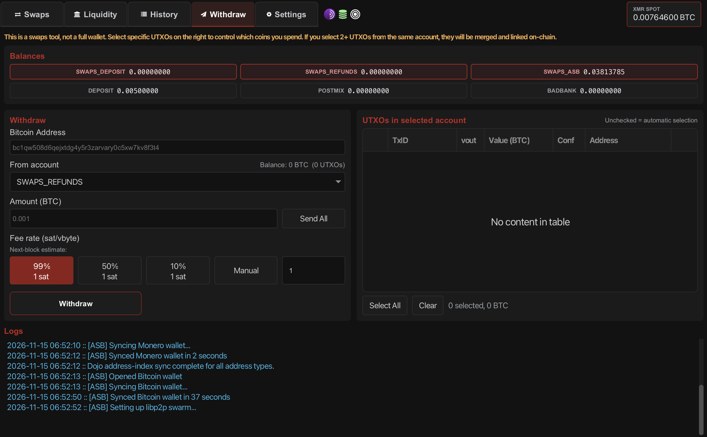

# Withdrawing BTC

The Withdraw tab sends BTC from the paired Ashigaru wallet to an external Bitcoin address. It is separate from the Swaps tab and does not create or resume an atomic swap. Outpost is intentionally swap-focused, not a general-purpose wallet.

## Contents

- [Before withdrawing](#before-withdrawing)
- [Accounts and balances](#accounts-and-balances)
- [Selecting coins](#selecting-coins)
- [Fees](#fees)
- [Broadcast and confirmation](#broadcast-and-confirmation)
- [Current limitations](#current-limitations)

## Documentation

- [Buying XMR](BUY_XMR.md)
- [Selling XMR](SELL_XMR.md)
- [Fees](FEES.md)
- [Settings](SETTINGS.md)
- [Swap architecture](ATOMIC_SWAPS.md)
- [Privacy and network routing](PRIVACY.md)
- [Security model](SECURITY.md)
- [Rendezvous points](RENDEZVOUS.md)
- [FAQ](FAQ.md)

## Before withdrawing

- The app must be paired with Ashigaru and its Dojo backend.
- Balances, UTXOs, fee estimates, and withdrawal broadcasts use Dojo over Tor. If Dojo is unavailable, the affected view shows unavailable; there is no Electrum fallback for withdrawals.
- Do not spend UTXOs that an active swap still needs. Use the Swaps tab while a swap is running.
- Protect the machine and the app data directory; they contain wallet material.

## Accounts and balances

The summary bar shows balances for Ashigaru accounts including `DEPOSIT`, `POSTMIX`, `BADBANK`, `SWAPS_DEPOSIT`, `SWAPS_REFUNDS`, and `SWAPS_ASB`.

By design, the withdrawal source selector supports:

- `SWAPS_DEPOSIT`
- `SWAPS_REFUNDS`
- `SWAPS_ASB`
- `BADBANK (P2WPKH)`

`DEPOSIT`, `PREMIX`, and `POSTMIX` are intentionally outside this withdrawal flow: `DEPOSIT` and `POSTMIX` appear in the summary for visibility, and `PREMIX` is not exposed here. Use Ashigaru to spend those accounts. This is a product-scope decision, not an address-type restriction.

The standard `DEPOSIT` account can contain Legacy, wrapped-SegWit, and native-SegWit UTXOs; `POSTMIX` is native-SegWit. Swap-specific accounts are native-SegWit. Change from a withdrawal is sent to the source account's native-SegWit change address.

See [Bitcoin accounts used by swaps](../README.md#bitcoin-accounts-used-by-swaps) for derivation paths.

## Selecting coins

> **Privacy warning:** spending multiple UTXOs together links them on-chain. Prefer the smallest set needed for the withdrawal; combining unrelated coins can reveal that they belong to the same wallet. **Send All** maximizes this linkage.

- Tick individual UTXOs to spend exactly those inputs.
- Use **Send All** to sweep the selected UTXOs, or the full account when nothing is ticked. The fee is deducted and the mode exits after broadcast.
- Without a ticked selection, the wallet performs automatic coin selection.

## Fees

Withdraw fees use the paired Dojo's confidence estimates:

- **99%** — next-block priority
- **50%** — balanced
- **10%** — slower/cheaper

You can also enter a manual sat/vB rate. If Dojo is unavailable, the manual field remains available; Withdraw never falls back to Electrum. Withdraw does not use the swap fee rules (buffers or path budget); see [Fees](FEES.md) for those.

## Broadcast and confirmation

The signed withdrawal is broadcast through Dojo. If Dojo is unavailable, the withdrawal fails rather than using Electrum. Wait for the transaction to appear in the UTXO/balance views; the summary refreshes when the tab opens and periodically.

## Current limitations

- Dojo outages can make balances and withdrawals unavailable.
- No additional spending tools beyond withdrawal and UTXO selection, such as the extra spending options available in Ashigaru Mobile; use Ashigaru for those.

